## UC-01: Register Account

*Performed by: Từ Thái Hưng | Reviewed by: Võ Minh Khang | Edited by: Từ Thái Hưng*

### 1. Use-Case Name – UC-01: Register Account

#### 1.1 Brief Description
This use case allows a Guest to create a new account in the Roomify system to become a Registered User. The Guest can register using a standard Email/Password or via third-party social accounts (Google, Facebook).

### 2. Flow of Events

#### 2.1 Basic Flow
This use case begins when the Guest chooses to register a new account.

1. The Guest clicks on the "Register" button.
2. The system displays the registration form requesting: Full Name, Email, Password, and Confirm Password.
3. The Guest enters valid information and clicks the "Đăng ký" (Submit) button.
4. The system validates the input format (e.g., matching passwords, valid email format).
5. The system verifies that the email does not already exist in the database.
6. The system creates a new user account, securely hashes the password, and saves the data.
7. The system redirects the user to the Login page. The use case ends.

#### 2.2 Alternative Flows

##### 2.2.1 2a. Register with Google
If at step 2 of the Basic Flow, the Guest clicks "Đăng ký bằng Google":
1. The system redirects to the Google OAuth page. 
2. Upon successful authentication, the system creates the account and logs them in. The use case ends.

##### 2.2.2 2b. Register with Facebook
If at step 2 of the Basic Flow, the Guest clicks "Đăng ký bằng Facebook":
1. The system redirects to the Facebook OAuth page. 
2. Upon successful authentication, the system creates the account and logs them in. The use case ends.

##### 2.2.3 4a. Missing or Invalid Input
If at step 4 of the Basic Flow, fields are blank or invalid:
1. The system displays an error message. 
2. The use case resumes at step 3 of the Basic Flow.

##### 2.2.4 4b. Passwords Do Not Match
If at step 4 of the Basic Flow, passwords do not match:
1. The system displays an error message. 
2. The use case resumes at step 3 of the Basic Flow.

##### 2.2.5 5a. Email Already Exists
If at step 5 of the Basic Flow, the email is already registered:
1. The system displays an error message. 
2. The use case resumes at step 3 of the Basic Flow.

### 3. Special Requirements

#### 3.1 Security Standard
- User passwords must be securely hashed. OAuth flows must comply with Google and Facebook security standards.

### 4. Preconditions

#### 4.1 Guest Status
- The Guest has opened the Roomify web application and is not currently logged in.

### 5. Postconditions

#### 5.1 Success Postcondition
- A new user account is successfully created.

#### 5.2 Failure Postcondition
- No user account is created, and the database remains unchanged.

### 6. Extension Points
- None.

### 7. UI Prototype

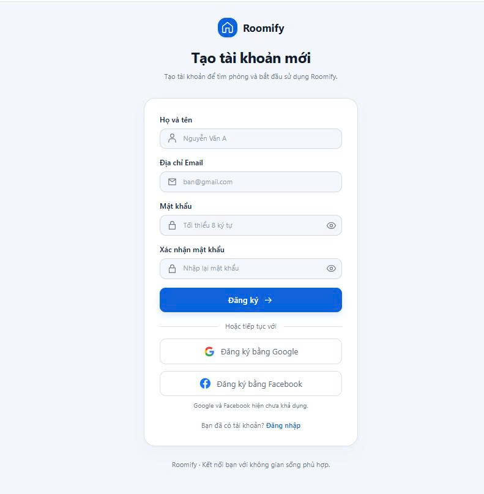  
*Figure UC-01: UI Prototype for Register Account*

---

## UC-02: Log In

*Performed by: Từ Thái Hưng | Reviewed by: Võ Minh Khang | Edited by: Từ Thái Hưng*

### 1. Use-Case Name – UC-02: Log In

#### 1.1 Brief Description
This use case allows a Guest to authenticate and access the Roomify system using their registered Email or via third-party social accounts (Google, Facebook).

### 2. Flow of Events

#### 2.1 Basic Flow
This use case begins when the Guest chooses to log in.

1. The Guest clicks on the "Log In" button on the navigation bar.
2. The system displays the login form.
3. The Guest enters their registered Email and Password, then clicks the "Đăng nhập" button.
4. The system validates the credentials against the database.
5. The system authenticates the user, establishes a secure session, and redirects them to the homepage. The use case ends.

#### 2.2 Alternative Flows

##### 2.2.1 3a. Log In with Google
If at step 3 of the Basic Flow, the Guest clicks "Đăng nhập bằng Google":
1. The system redirects to the Google OAuth page. 
2. Upon successful external authentication, the system logs the user in and redirects to the homepage. The use case ends.

##### 2.2.2 3b. Log In with Facebook
If at step 3 of the Basic Flow, the Guest clicks "Đăng nhập bằng Facebook":
1. The system redirects to the Facebook OAuth page. 
2. Upon successful external authentication, the system logs the user in and redirects to the homepage. The use case ends.

##### 2.2.3 4a. Invalid Credentials
If at step 4 of the Basic Flow, the input combination is incorrect:
1. The system displays an error message. 
2. The use case resumes at step 3 of the Basic Flow.

##### 2.2.4 3c. Missing Input
If at step 3 of the Basic Flow, the Guest leaves required fields blank:
1. The system prevents submission and highlights the fields. 
2. The use case resumes at step 3 of the Basic Flow.

### 3. Special Requirements

#### 3.1 Security Standard
* Passwords must be verified securely. OAuth flows must comply with Google and Facebook API security standards.

### 4. Preconditions

#### 4.1 Guest Status
* The Guest has opened the Roomify web application and is not logged in.

### 5. Postconditions

#### 5.1 Success Postcondition
* The Guest is successfully authenticated and transitions to a Registered User state.

#### 5.2 Failure Postcondition
* The Guest remains unauthenticated.

### 6. Extension Points

#### 6.1 Reset Password Decision
* At step 3 of the Basic Flow, if the Guest clicks "Quên mật khẩu?", **UC-03 (Reset Password)** is triggered.

### 7. UI Prototype

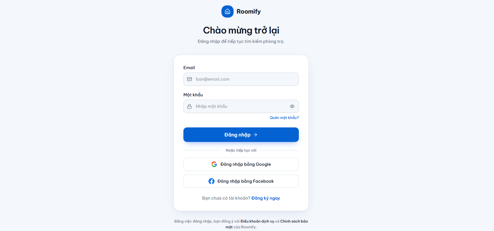  
*Figure UC-02: UI Prototype for Log In*

---

## UC-03: Reset Password

*Performed by: Từ Thái Hưng | Reviewed by: Võ Minh Khang | Edited by: Từ Thái Hưng*

### 1. Use-Case Name – UC-03: Reset Password

#### 1.1 Brief Description
This use case extends **UC-02 (Log In)** and allows a Guest who has forgotten their password to reset it by requesting a password reset link sent to their registered email.

### 2. Flow of Events

#### 2.1 Basic Flow
This use case begins at the *Reset Password Decision* extension point in **UC-02 (Log In)**.

1. The Guest clicks on the "Quên mật khẩu?" (Forgot Password) link.
2. The system displays the Reset Password form requesting the registered Email.
3. The Guest enters their Email and clicks the "Gửi liên kết" (Send Link) button.
4. The system validates that the Email exists in the database.
5. The system generates a time-limited reset token and sends it to the Guest's email.
6. The system displays a success message indicating the email has been sent. The use case ends.

#### 2.2 Alternative Flows

##### 2.2.1 4a. Email Not Found
If at step 4 of the Basic Flow, the entered email is not registered:
1. The system displays an error message. 
2. The use case resumes at step 3 of the Basic Flow.

##### 2.2.2 4b. Invalid Format
If at step 4 of the Basic Flow, the email format is invalid:
1. The system displays a validation error. 
2. The use case resumes at step 3 of the Basic Flow.

### 3. Special Requirements

#### 3.1 Token Expiration
* Reset tokens must be securely generated and expire after a short period (e.g., 15 minutes).

### 4. Preconditions

#### 4.1 Login Screen Active
* The Guest is on the Login page attempting to authenticate.

### 5. Postconditions

#### 5.1 Success Postcondition
* A password reset link is successfully sent to the user's email.

#### 5.2 Failure Postcondition
* No reset link is sent.

### 6. Extension Points
* None.

### 7. UI Prototype

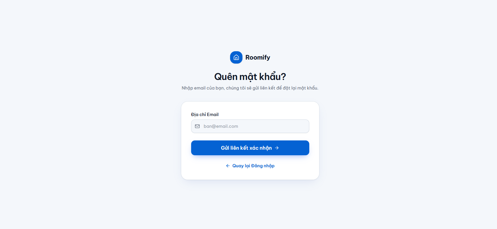  
*Figure UC-03: UI Prototype for Reset Password*

---

## UC-04: Log Out

*Performed by: Từ Thái Hưng | Reviewed by: Võ Minh Khang | Edited by: Từ Thái Hưng*

### 1. Use-Case Name – UC-04: Log Out

#### 1.1 Brief Description
This use case allows a logged-in user (Tenant, Landlord, Administrator) to securely end their active session in the Roomify system and return to the Guest state.

### 2. Flow of Events

#### 2.1 Basic Flow
This use case begins when the user decides to log out.

1. The user clicks on their profile avatar or account menu on the top navigation bar.
2. The system displays a dropdown menu with account options.
3. The user selects the "Log Out" (Đăng xuất) option.
4. The system terminates the active user session and clears all authentication tokens/cookies.
5. The system redirects the user to the public homepage (or Login page) and updates the UI to show Guest options (Register/Log In). The use case ends.

#### 2.2 Alternative Flows

##### 2.2.1 1a. Session Timeout
If the user is inactive for a specified period:
1. The system automatically terminates the session and logs the user out. 
2. The next time the user attempts to access a protected route, they are redirected to the Login page. The use case ends.

### 3. Special Requirements

#### 3.1 Security Standard
* All session data and tokens (e.g., JWT) must be securely destroyed or invalidated on both the client and server sides to prevent session hijacking.

### 4. Preconditions

#### 4.1 Authenticated User
* The user is currently authenticated and logged into the Roomify application.

### 5. Postconditions

#### 5.1 Success Postcondition
* The user's session is completely terminated and the user loses access to role-specific features.

#### 5.2 Failure Postcondition
* None.

### 6. Extension Points
* None.

### 7. UI Prototype

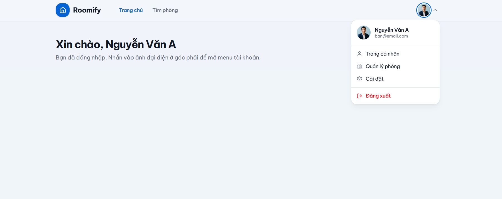  
*Figure UC-04: UI Prototype for Log Out*

---

## UC-05: Manage Profile

*Performed by: Từ Thái Hưng | Reviewed by: Võ Minh Khang | Edited by: Từ Thái Hưng*

### 1. Use-Case Name – UC-05: Manage Profile

#### 1.1 Brief Description
This use case allows a logged-in user (Tenant, Landlord, Admin) to view and update their personal profile information, such as their full name, phone number, and avatar.

### 2. Flow of Events

#### 2.1 Basic Flow
This use case begins when the user accesses their profile.

1. The user navigates to the "Trang cá nhân" (Profile) page from the navigation menu.
2. The system displays a form containing the user's current profile information (Avatar, Name, Email, Phone Number, and Role).
3. The user modifies their editable details (e.g., uploads a new avatar, updates their phone number) and clicks the "Lưu thay đổi" (Save Changes) button.
4. The system validates the input data (e.g., correct phone number format).
5. The system updates the profile data in the database.
6. The system displays a success notification and refreshes the displayed profile information. The use case ends.

#### 2.2 Alternative Flows

##### 2.2.1 4a. Invalid Input
If at step 4 of the Basic Flow, the provided data is invalid (e.g., phone number contains letters):
1. The system displays a validation error message next to the corresponding field. 
2. The use case resumes at step 3 of the Basic Flow.

##### 2.2.2 3a. Cancel Edit
If at step 3 of the Basic Flow, the user clicks "Hủy" (Cancel):
1. The system discards any unsaved changes and reloads the original profile data. The use case ends.

### 3. Special Requirements

#### 3.1 Field Restrictions
* The user's Email and Role are typically read-only and cannot be changed from this interface.

#### 3.2 Media Upload Limits
* Avatar image uploads must be restricted by file size and format (e.g., max 2MB, JPG/PNG only).

### 4. Preconditions

#### 4.1 Authenticated User
* The user is currently authenticated and logged into the Roomify system.

### 5. Postconditions

#### 5.1 Success Postcondition
* The user's profile information is successfully updated in the database and reflected across the UI.

#### 5.2 Failure Postcondition
* The user's profile information remains unchanged.

### 6. Extension Points
* None.

### 7. UI Prototype

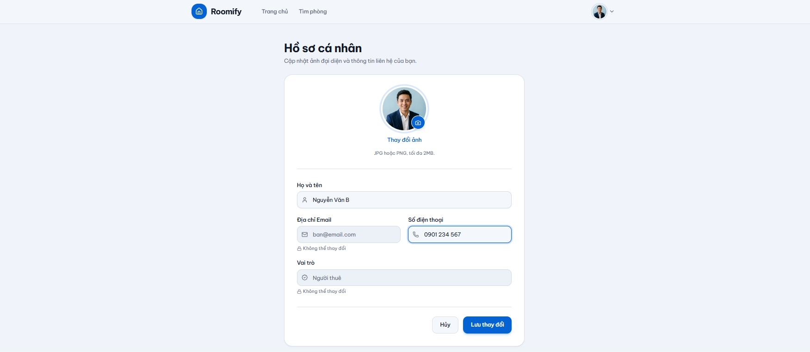  
*Figure UC-05: UI Prototype for Manage Profile*

---

## UC-06: Search Listings with Filters

*Performed by: Từ Thái Hưng | Reviewed by: Võ Minh Khang | Edited by: Từ Thái Hưng*

### 1. Use-Case Name – UC-06: Search Listings with Filters

#### 1.1 Brief Description
This use case allows a Guest to search for available boarding house listings using keywords and apply various filters (such as price range, location, and amenities) to narrow down the results.

### 2. Flow of Events

#### 2.1 Basic Flow
This use case begins when the Guest navigates to the search interface.

1. The Guest navigates to the Search page or uses the search bar on the homepage.
2. The Guest enters search keywords (e.g., street name, district) into the search bar.
3. The Guest selects specific filters in the filter panel (e.g., maximum price, property type, required amenities).
4. The Guest clicks the "Áp dụng" (Apply) button.
5. The system queries the database for approved listings that match all specified criteria.
6. The system displays a paginated list or grid of the matching listings. The use case ends.

#### 2.2 Alternative Flows

##### 2.2.1 5a. No Results Found
If at step 5 of the Basic Flow, no listings match the criteria:
1. The system displays a friendly message indicating no results were found and suggests adjusting or clearing the filters. 
2. The use case resumes at step 3 of the Basic Flow.

##### 2.2.2 3a. Clear Filters
If at step 3 of the Basic Flow, the Guest clicks a "Xóa bộ lọc" (Clear Filters) button:
1. The system resets all filters to their default state and displays all available approved listings. 
2. The use case resumes at step 6 of the Basic Flow.

### 3. Special Requirements

#### 3.1 Approved Listings Only
* Search results must only include listings that have been officially approved by an Admin.

### 4. Preconditions

#### 4.1 System Access
* The Guest has opened the Roomify web application.

### 5. Postconditions

#### 5.1 Success Postcondition
* The system displays a list of listings that perfectly match the user's search criteria.

#### 5.2 Failure Postcondition
* No search results are displayed due to system error.

### 6. Extension Points
* None.

### 7. UI Prototype

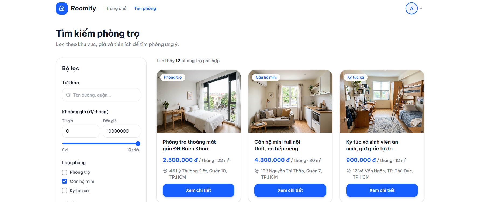  
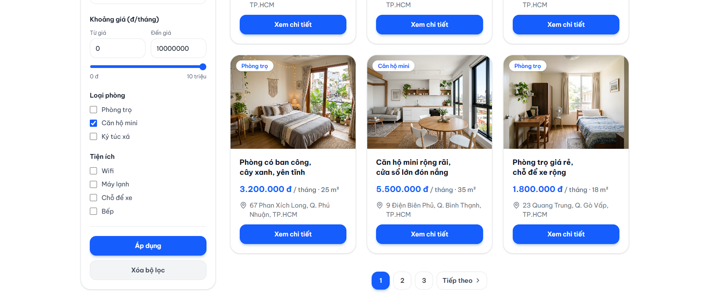  
*Figure UC-06: UI Prototype for Search Listings with Filters*

---

## UC-07: View Listings on Map

*Performed by: Từ Thái Hưng | Reviewed by: Võ Minh Khang | Edited by: Từ Thái Hưng*

### 1. Use-Case Name – UC-07: View Listings on Map

#### 1.1 Brief Description
This use case allows a Guest to view available boarding house listings on an interactive map powered by Google Maps Platform. This provides a geographical overview of property locations and allows users to explore listings based on specific areas.

### 2. Flow of Events

#### 2.1 Basic Flow
This use case begins when the Guest switches to the Map view.

1. The Guest clicks the "Bản đồ" (Map view) toggle on the Search page.
2. The system requests the map rendering interface from the Google Maps Platform.
3. The system retrieves all approved listings and their geographical coordinates from the database.
4. The system displays the interactive map with markers (pins) representing the available listings.
5. The Guest clicks on a specific marker on the map.
6. The system displays a pop-up window (Info Window) over the marker, showing a brief summary of the listing (thumbnail, price, title).
7. The Guest clicks on the pop-up to view the full details of the listing.
8. The system triggers **UC-08 (View Listing Details)**. The use case ends.

#### 2.2 Alternative Flows

##### 2.2.1 2a. Google Maps API Failure
If at step 2 of the Basic Flow, the Google Maps Platform is unreachable or returns an error:
1. The system displays a fallback error message (e.g., "Không thể tải bản đồ lúc này") and suggests the user switch back to the List view. The use case ends.

##### 2.2.2 4a. Filter on Map
If at step 4 of the Basic Flow, the Guest applies filters via a floating filter panel:
1. The system dynamically updates the map markers to display only the listings that match the new criteria. 
2. The use case resumes at step 4 of the Basic Flow.

### 3. Special Requirements

#### 3.1 Performance
* If there are too many listings in a specific area, the system should use marker clustering to maintain performance and map readability.

#### 3.2 External API
* Requires a valid API Key and connection to the Google Maps Platform.

### 4. Preconditions

#### 4.1 System Access
* The Guest has opened the Roomify web application.

### 5. Postconditions

#### 5.1 Success Postcondition
* The Guest successfully views the spatial distribution of the listings on an interactive map.

#### 5.2 Failure Postcondition
* The map fails to load.

### 6. Extension Points
* None.

### 7. UI Prototype

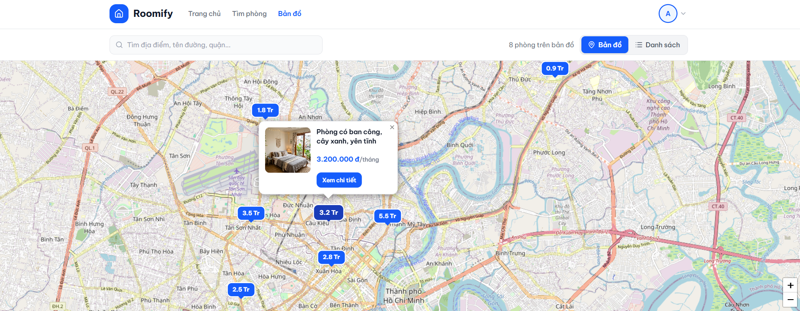  
*Figure UC-07: UI Prototype for View Listings on Map*

---

## UC-08: View Listing Details

*Performed by: Từ Thái Hưng | Reviewed by: Võ Minh Khang | Edited by: Từ Thái Hưng*

### 1. Use-Case Name – UC-08: View Listing Details

#### 1.1 Brief Description
This use case allows a Guest to view the complete details of a specific boarding house listing, including an image gallery, detailed description, amenities, and automatically retrieved nearby places (e.g., schools, stores).

### 2. Flow of Events

#### 2.1 Basic Flow
This use case begins when the Guest selects a listing to view.

1. The Guest clicks on a listing card (from **UC-06**) or a map info pop-up (from **UC-07**).
2. The system retrieves the full details of the selected listing from the database, including pre-calculated nearby geographic information.
3. The system displays the Listing Details page, showing the image gallery, title, price, address, description, amenities, and nearby places.
4. The Guest scrolls through the page to review the provided information. The use case ends.

#### 2.2 Alternative Flows

##### 2.2.1 2a. Listing Unavailable
If at step 2 of the Basic Flow, the listing has been deleted, hidden, or is no longer approved:
1. The system displays an error message ("Phòng trọ không tồn tại hoặc đã bị gỡ") and provides a button to return to the Search page. The use case ends.

### 3. Special Requirements

#### 3.1 Data Retrieval Efficiency
* Nearby places (schools, convenience stores) should load quickly from the database, as they are populated during the Admin approval phase (**UC-21**).

### 4. Preconditions

#### 4.1 Active Browsing
* The Guest is browsing the Search Listings page or the Map view.

### 5. Postconditions

#### 5.1 Success Postcondition
* The Guest is successfully presented with all public details of the selected listing.

#### 5.2 Failure Postcondition
* The listing details are not displayed.

### 6. Extension Points

#### 6.1 View Contact Information
* At step 4 of the Basic Flow, if the Guest clicks the "Xem thông tin liên hệ" (View Contact) button, **UC-09 (View Landlord Contact Information)** is triggered.

### 7. UI Prototype

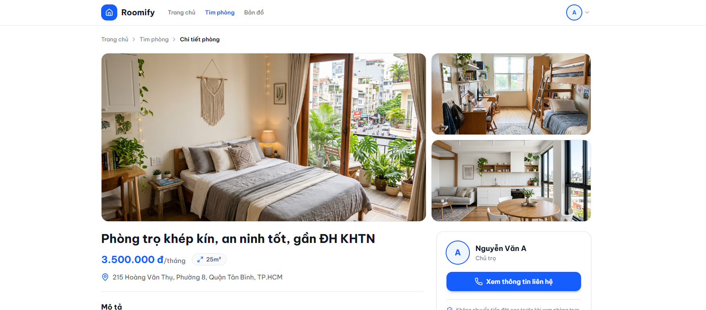  
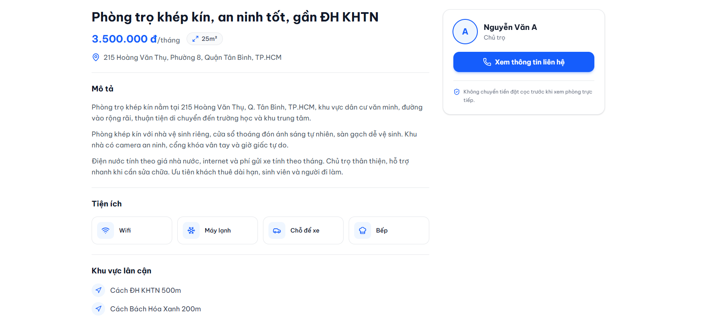  
*Figure UC-08: UI Prototype for View Listing Details*

---

## UC-09: View Landlord Contact Information

*Performed by: Từ Thái Hưng | Reviewed by: Võ Minh Khang | Edited by: Từ Thái Hưng*

### 1. Use-Case Name – UC-09: View Landlord Contact Information

#### 1.1 Brief Description
This use case extends **UC-08 (View Listing Details)** and allows an authenticated user to reveal and view the hidden contact details (such as phone number and Zalo link) of the landlord associated with a specific listing.

### 2. Flow of Events

#### 2.1 Basic Flow
This use case begins at the *View Contact Information* extension point in **UC-08**.

1. The user clicks the "Xem thông tin liên hệ" (View Contact Information) button on the landlord profile card.
2. The system verifies that the user is currently logged in (authenticated).
3. The system retrieves the landlord's private contact details from the database.
4. The system dynamically updates the UI to reveal the contact information (e.g., Phone number, Zalo, Email) in place of the button, or displays it in a modal popup. The use case ends.

#### 2.2 Alternative Flows

##### 2.2.1 2a. User Not Logged In (Guest)
If at step 2 of the Basic Flow, the system detects the user is a Guest:
1. The system displays a prompt stating "Vui lòng đăng nhập để xem thông tin liên hệ". 
2. The system provides links to Log In (**UC-02**) or Register (**UC-01**). 
3. Once the user successfully logs in, they are redirected back to the Listing Details page. The use case ends.

##### 2.2.2 3a. Contact Info Unavailable
If at step 3 of the Basic Flow, the landlord has not provided a specific contact method (e.g., no Zalo link):
1. The system only displays the available methods (e.g., just the phone number). The use case ends.

### 3. Special Requirements

#### 3.1 Privacy & Security
* Contact information must never be included in the initial API payload for Guests. It must only be fetched securely via an authenticated API request.

### 4. Preconditions

#### 4.1 Listing Page Active
* The user is viewing a specific Listing Details page (**UC-08**).

### 5. Postconditions

#### 5.1 Success Postcondition
* The user successfully views the landlord's contact information.

#### 5.2 Failure Postcondition
* The contact information remains hidden.

### 6. Extension Points
* None.

### 7. UI Prototype

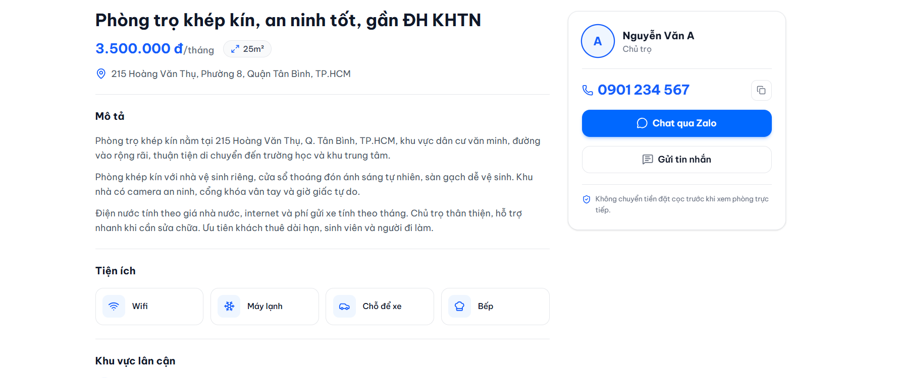  
*Figure UC-09: UI Prototype for View Landlord Contact Information*

---

## UC-10: Manage Favorite Listings

*Performed by: Từ Thái Hưng | Reviewed by: Võ Minh Khang | Edited by: Từ Thái Hưng*

### 1. Use-Case Name – UC-10: Manage Favorite Listings

#### 1.1 Brief Description
This use case allows a logged-in Tenant to save specific boarding house listings to a personal "Favorites" list for later review and comparison. Tenants can also remove listings from this list.

### 2. Flow of Events

#### 2.1 Basic Flow
This use case begins when the Tenant decides to save a listing or view their saved listings.

1. The Tenant browses listings on the Search page (**UC-06**) or views a specific Listing Details page (**UC-08**).
2. The Tenant clicks the "Trái tim" (Heart / Save) icon on a listing.
3. The system saves the listing ID to the Tenant's favorites list in the database.
4. The system updates the UI, changing the Heart icon to a filled/active state (e.g., solid red or blue) and displays a quick success toast notification.
5. The Tenant navigates to the "Phòng đã lưu" (Saved/Favorite Listings) page via the user dropdown menu.
6. The system retrieves and displays a grid of all listings the Tenant has saved. The use case ends.

#### 2.2 Alternative Flows

##### 2.2.1 2a. Remove from Favorites
If at step 2 of the Basic Flow, the Tenant clicks an already filled Heart icon:
1. The system removes the listing from their favorites list and changes the icon back to an empty state. 
2. If done from the "Saved Listings" page, the listing card disappears from the grid after a refresh. The use case ends.

##### 2.2.2 6a. Empty Favorites List
If at step 6 of the Basic Flow, the Tenant has not saved any listings:
1. The system displays a friendly empty state message (e.g., "Bạn chưa lưu phòng trọ nào") with a button to "Khám phá phòng trọ". The use case ends.

### 3. Special Requirements

#### 3.1 Availability Synchronization
* If a saved listing is subsequently deleted by the Landlord or rejected by the Admin, it should be marked as "Không còn khả dụng" (Unavailable) or automatically removed from the Tenant's favorites list.

### 4. Preconditions

#### 4.1 Authenticated Tenant
* The user is authenticated and logged into the Roomify system with the "Tenant" role.

### 5. Postconditions

#### 5.1 Success Postcondition
* The Tenant's favorites list is successfully updated and persistent across sessions.

#### 5.2 Failure Postcondition
* The favorites list remains unchanged.

### 6. Extension Points
* None.

### 7. UI Prototype

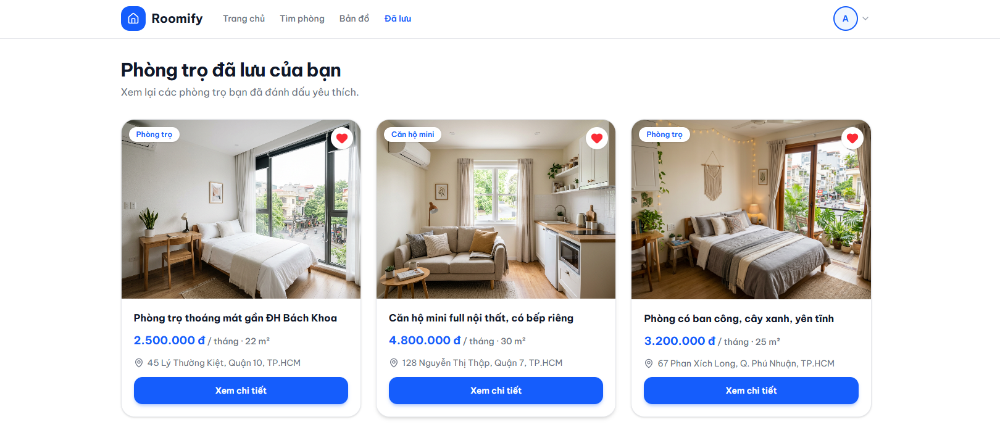  
*Figure UC-10: UI Prototype for Manage Favorite Listings*

---

## UC-11: Chat with AI Assistant

*Performed by: Từ Thái Hưng | Reviewed by: Võ Minh Khang | Edited by: Từ Thái Hưng*

### 1. Use-Case Name – UC-11: Chat with AI Assistant

#### 1.1 Brief Description
This use case allows a Guest to interact with an AI-powered chatbot (via an external LLM Service) to ask questions regarding boarding house rentals, get platform navigation help, and receive instant, natural-language support.

### 2. Flow of Events

#### 2.1 Basic Flow
This use case begins when the Guest accesses the AI chat widget.

1. The Guest clicks the AI floating chat widget icon located at the bottom right of the screen.
2. The system expands the widget into a chat window and displays a welcome message.
3. The Guest types a question (e.g., "Làm sao để tìm phòng giá rẻ ở Thủ Đức?") into the input field and clicks the Send button.
4. The system displays the Guest's message in the chat window.
5. The system sends the user's prompt securely to the external LLM Service.
6. The LLM Service processes the prompt and returns a generated text response.
7. The system displays the AI's response in the chat window. The use case ends.

#### 2.2 Alternative Flows

##### 2.2.1 6a. LLM Service Timeout/Error
If at step 6 of the Basic Flow, the LLM Service fails to respond within a specific timeframe or returns an error:
1. The system displays a fallback message in the chat window (e.g., "Xin lỗi, trợ lý AI hiện đang bận. Vui lòng thử lại sau.") and logs the error. The use case ends.

##### 2.2.2 3a. Empty Input
If at step 3 of the Basic Flow, the Guest attempts to send an empty message:
1. The system disables the send button or ignores the action. 
2. The use case resumes at step 3 of the Basic Flow.

### 3. Special Requirements

#### 3.1 Latency
* The system should display a "typing..." indicator while waiting for the LLM Service's response to improve UX.

### 4. Preconditions

#### 4.1 System and Service Availability
* The Guest has opened the Roomify web application.
* The LLM Service (e.g., Gemini or Claude API) is operational.

### 5. Postconditions

#### 5.1 Success Postcondition
* The Guest receives a helpful, context-aware answer from the AI assistant, and chat history is maintained for the duration of the current session.

#### 5.2 Failure Postcondition
* The system displays an error message, but the chat history remains.

### 6. Extension Points

#### 6.1 Recommendation Request
* If the Guest expresses a specific intent to find or compare boarding houses, **UC-12 (Get Listing Recommendations)** is triggered.

### 7. UI Prototype

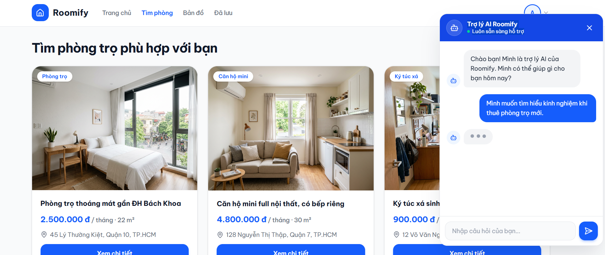  
*Figure UC-11: UI Prototype for Chat with AI Assistant*

---

## UC-12: Get Listing Recommendations

*Performed by: Đỗ Quốc Đại | Reviewed by: Võ Minh Khang | Edited by: Đỗ Quốc Đại*

### 1. Use-Case Name – UC-12: Get Listing Recommendations

#### 1.1 Brief Description
This use case extends **UC-11 (Chat with AI Assistant)** when the user expresses a specific intent to find or compare boarding houses based on natural-language preferences (such as monthly budget, target university or district, desired amenities, or proximity to grocery stores). The system queries approved listings matching the extracted criteria, uses the LLM Service to generate a personalized explanation, and presents interactive listing recommendation cards inside the chat thread.

### 2. Flow of Events

#### 2.1 Basic Flow
This use case begins at the *Recommendation Request* extension point in **UC-11 (Chat with AI Assistant)** when the Guest submits a chat message asking for boarding house suggestions.

1. The Guest enters a natural-language recommendation request in the chat input box (for example, specifying maximum monthly rent, preferred area or university, and required amenities) and clicks the **Send** button.
2. The system analyzes the message, detects a listing recommendation intent, and extracts structured search parameters (such as price range, location keywords, minimum area, and amenities).
3. The system queries the database for boarding house listings with status **Approved** that match the extracted parameters.
4. The system sends the user's prompt along with the summary data of the top matching approved listings to the **LLM Service**.
5. The **LLM Service** generates a natural-language recommendation response explaining why the selected listings fit the Guest's needs and returns it to the system.
6. The system displays the AI's explanation message in the conversation thread together with interactive **Recommended Listing Cards** (each showing the room thumbnail photo, title, monthly rent in VND, area in $\text{m}^2$, address/nearby summary, and a **View Details** button).
7. The Guest reviews the recommended listing cards and optionally clicks **View Details** on a card to open **UC-08 (View Listing Details)**. The use case ends, returning control to **UC-11**.

#### 2.2 Alternative Flows

##### 2.2.1 2a. Ambiguous or Insufficient Recommendation Criteria
If at step 2 of the Basic Flow, the Guest asks for recommendations without providing enough criteria (for example, *"Recommend a room for me"* with no location or budget):
1. The system prompts the **LLM Service** to generate a clarifying question asking the Guest for their preferred area/school and monthly budget range.
2. The Guest replies with the requested details.
3. The use case resumes at step 2 of the Basic Flow.

##### 2.2.2 3a. No Exact Matching Approved Listings Found
If at step 3 of the Basic Flow, no **Approved** listings match all of the Guest's strict criteria:
1. The system relaxes the secondary filter constraints (for example, expanding the price range by $\pm 15\%$ or broadening the area search) to find the closest available **Approved** alternatives.
2. If alternative approved listings are found, the system informs the Guest that no exact match was found and displays the closest matching listing cards.
3. If no approved listings match even after relaxing constraints, the system informs the Guest that no suitable listings are currently available and suggests trying broader search criteria or using **UC-06 (Search Listings with Filters)**. The use case ends.

##### 2.2.3 4a. LLM Service Timeout or Unavailable
If at step 4 or 5 of the Basic Flow, the **LLM Service** fails to respond within the timeout period:
1. The system logs the external service timeout error.
2. The system displays a fallback message (*"Here are the top approved listings matching your criteria:"*) along with the matching **Recommended Listing Cards** retrieved from the database at step 3 so the Guest can still browse results. The use case ends.

### 3. Special Requirements

#### 3.1 Approved Listings Only
* Recommendations generated in this use case must strictly use listings with status **Approved**. Listings with status **Pending** or **Rejected** must never be sent to the LLM Service or recommended to users.

#### 3.2 Response Time
* The system should display the AI recommendation text and listing cards within $5\text{ seconds}$ under normal network conditions.

### 4. Preconditions

#### 4.1 Active AI Chat Session
* The Guest is currently interacting with the AI chatbot interface in **UC-11 (Chat with AI Assistant)**.

#### 4.2 Available Approved Listings
* The database contains boarding house listings that have been approved by an Admin (**UC-19**).

### 5. Postconditions

#### 5.1 Success Postcondition
* The chat conversation displays a tailored recommendation message and interactive cards for matching **Approved** listings.

#### 5.2 Failure Postcondition
* If no listings match or an unrecoverable error occurs, the system displays a helpful fallback message and the chat session remains active.

### 6. Extension Points
* None.

### 7. UI Prototype

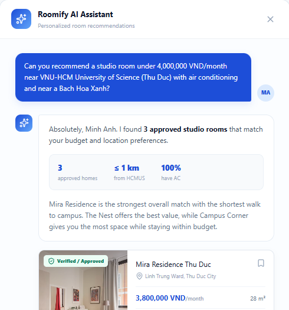  
*Figure UC-12: UI Prototype for Get Listing Recommendations*

---

## UC-13: Post Listing

*Performed by: Đỗ Quốc Đại | Reviewed by: Võ Minh Khang | Edited by: Đỗ Quốc Đại*

### 1. Use-Case Name – UC-13: Post Listing

#### 1.1 Brief Description
This use case allows a logged-in Landlord to create and submit a new boarding house listing on Roomify. The Landlord provides room details, rent price, amenities, and room photos, and selects the exact geographic location on the map (**UC-14**). Every newly submitted listing is saved with status **Pending** and must be approved by an Admin before becoming publicly visible.

### 2. Flow of Events

#### 2.1 Basic Flow
This use case begins when the Landlord chooses to create a new boarding house listing.

1. The Landlord clicks the **Post New Listing** button on the navigation sidebar or the Landlord dashboard.
2. The system displays the **Post Listing Form** with input sections for basic details, pricing, amenities, location selection, and room photos.
3. The Landlord enters the required listing details:
   * **Listing Title**
   * **Detailed Description**
   * **Monthly Rent Price (VND)** and **Security Deposit (VND)**
   * **Room Area ($\text{m}^2$)** and **Maximum Occupancy**
   * **Amenities** (selecting applicable checkboxes such as Air Conditioning, Private Bathroom, Wi-Fi, Parking, Kitchen, Security Camera, No Curfew)
4. The Landlord selects the boarding house's street address and exact map coordinates by executing **UC-14 (Select Location on Map)**.
5. The Landlord uploads between $1$ and $10$ photos of the boarding house (`JPG`, `PNG`, or `WEBP` format).
6. The Landlord reviews the entered information and clicks the **Submit for Approval** button.
7. The system validates all required input fields, numeric ranges, location coordinates, and uploaded photo files.
8. The system saves the new listing record in the database with status **Pending** and associates it with the Landlord's account.
9. The system displays a confirmation message (*"Your listing has been submitted successfully and is pending administrator approval"*) and redirects the Landlord to **UC-15 (View My Listings)**. The use case ends.

#### 2.2 Alternative Flows

##### 2.2.1 7a. Missing or Invalid Required Fields
If at step 7 of the Basic Flow, any required field (title, description, monthly rent, area) is empty, or if the rent price or area is less than or equal to $0$:
1. The system highlights the invalid or empty input fields in red and displays descriptive validation messages next to each field.
2. The use case resumes at step 3 of the Basic Flow so the Landlord can correct the input.

##### 2.2.2 4a. Location Not Selected on Map
If at step 7 of the Basic Flow, the Landlord attempts to submit the form without confirming a location via **UC-14 (Select Location on Map)**:
1. The system prevents submission and displays an error message: *"Please select and confirm the boarding house location on the map."*
2. The use case resumes at step 4 of the Basic Flow.

##### 2.2.3 5a. Invalid Photo Format, File Size Exceeded, or No Photos Uploaded
If at step 5 or 7 of the Basic Flow, the Landlord uploads a file that is not an image (`JPG`, `PNG`, `WEBP`), exceeds $5\text{ MB}$ per file, exceeds $10$ photos, or submits without any photo:
1. The system rejects the invalid file(s) and displays an error message: *"Please upload between 1 and 10 valid room photos (JPG, PNG, or WEBP, maximum 5 MB per photo)."*
2. The use case resumes at step 5 of the Basic Flow.

##### 2.2.4 6a. Landlord Cancels Listing Creation
If at any point before clicking **Submit for Approval**, the Landlord clicks the **Cancel** button:
1. The system displays a confirmation dialog warning that unsaved changes will be lost.
2. If the Landlord confirms cancellation, the system discards the form data and returns the Landlord to the previous page. The use case ends.
3. If the Landlord dismisses the dialog, the use case resumes at the current step of the Basic Flow.

### 3. Special Requirements

#### 3.1 Moderation Policy
* A newly created listing must always start with status **Pending** and must not appear in public search results (**UC-06**), map views (**UC-07**), or AI recommendations (**UC-12**) until approved by an Admin (**UC-19**).

#### 3.2 Media Upload Limits
* Each listing requires at least $1$ photo and at most $10$ photos, with a maximum file size of $5\text{ MB}$ per photo.

### 4. Preconditions

#### 4.1 Authenticated Landlord
* The user is logged into the system (**UC-02**) and holds the **Landlord** role.

### 5. Postconditions

#### 5.1 Success Postcondition
* A new boarding house listing is stored in the database with status **Pending**, complete with verified coordinates from **UC-14** and uploaded room prototypes.

#### 5.2 Failure Postcondition
* No new listing record is created in the database.

### 6. Extension Points
* None.

### 7. UI Prototype

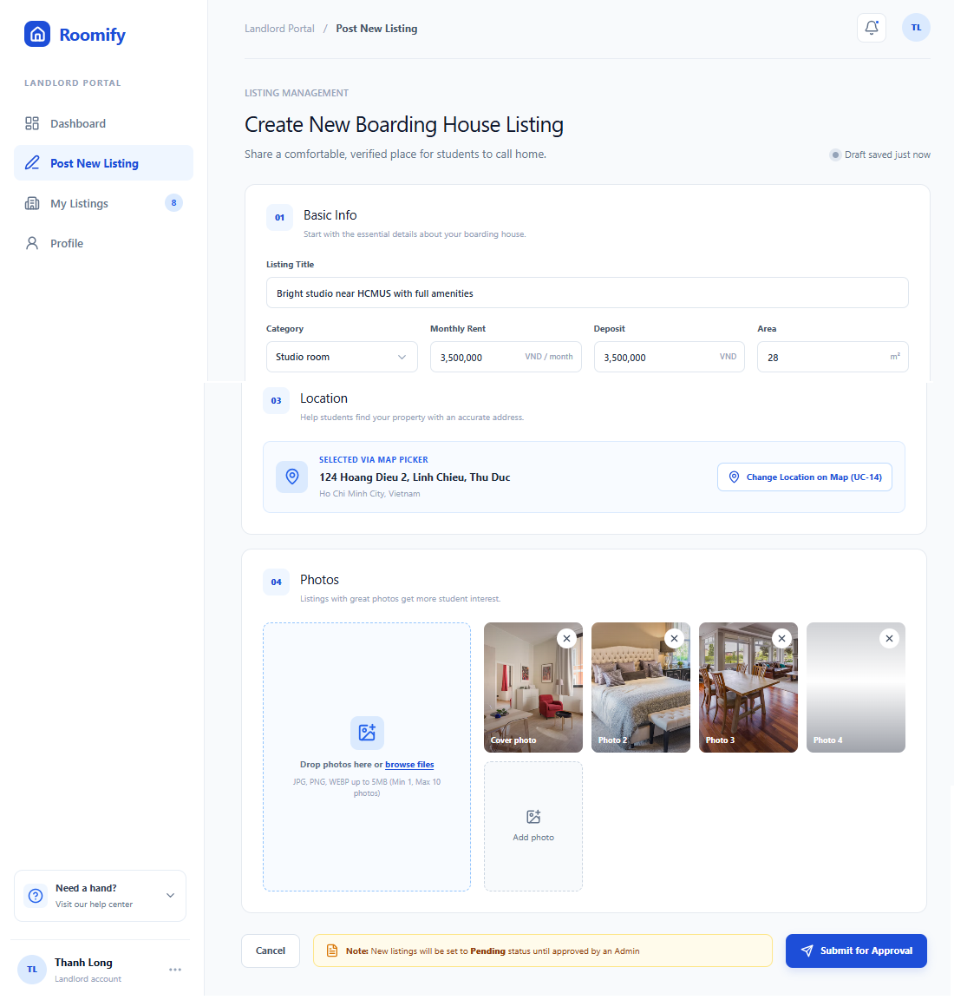  
*Figure UC-13: UI Prototype for Post Listing*

---

## UC-14: Select Location on Map

*Performed by: Đỗ Quốc Đại | Reviewed by: Võ Minh Khang | Edited by: Đỗ Quốc Đại*

### 1. Use-Case Name – UC-14: Select Location on Map

#### 1.1 Brief Description
This use case enables a Landlord to pinpoint the exact geographic location of a boarding house using an interactive map powered by the **Google Maps Platform**. The Landlord can search for an address and drag a map pin to capture accurate latitude and longitude coordinates along with a standardized street address.

### 2. Flow of Events

#### 2.1 Basic Flow
This use case begins when **UC-13 (Post Listing)** (or **UC-16 (Edit Listing)**) invokes the map location selector.

1. The Landlord clicks the **Select Location on Map** (or **Change Location on Map**) button on the listing form.
2. The system requests an interactive map view from the **Google Maps Platform** and displays the **Map Location Picker** modal containing an address search bar, an interactive map canvas, and a coordinates summary panel.
3. The Landlord types the street address, ward, or landmark into the address search bar.
4. The system queries the **Google Maps Platform** (Places Autocomplete / Geocoding API) and displays a dropdown list of matching address suggestions.
5. The Landlord selects the appropriate address from the suggestions list.
6. The system centers the map on the selected address, places a draggable marker pin at that position, and displays the corresponding **Latitude**, **Longitude**, and **Formatted Address**.
7. The Landlord optionally drags and drops the marker pin on the map canvas to fine-tune the exact entrance of the boarding house.
8. The system requests reverse geocoding from the **Google Maps Platform** for the new pin position and updates the displayed coordinates and formatted address.
9. The Landlord clicks the **Confirm Location** button.
10. The system passes the confirmed formatted address, latitude, and longitude back to the parent listing form and closes the Map Location Picker. The use case ends.

#### 2.2 Alternative Flows

##### 2.2.1 4a. Address Search Returns No Results
If at step 4 of the Basic Flow, the **Google Maps Platform** returns no matching suggestions for the entered text:
1. The system displays a message: *"No matching address found. Please try a broader street or ward name, or drag the pin directly on the map."*
2. The Landlord manually pans/zooms the map and places the marker pin (resuming at step 7 of the Basic Flow).

##### 2.2.2 2a. Google Maps Platform Unavailable
If at step 2 or 4 of the Basic Flow, the **Google Maps Platform** fails to load or returns a network/API error:
1. The system displays an error banner: *"Unable to connect to Google Maps Platform. Please check your internet connection and click Retry."*
2. If the Landlord clicks **Retry**, the use case resumes at step 2 of the Basic Flow; otherwise, the Landlord closes the modal and the use case terminates without updating the location.

##### 2.2.3 9a. Landlord Cancels Location Selection
If at any time before clicking **Confirm Location**, the Landlord clicks **Cancel** or closes the modal:
1. The system discards any unconfirmed pin changes and returns to the listing form with the previous location state unchanged. The use case ends.

### 3. Special Requirements

#### 3.1 Coordinate Precision
* Latitude and longitude values must be stored as floating-point numbers with at least $6$ decimal places of precision so that **UC-21 (Retrieve Nearby Information)** can accurately calculate distances to nearby schools and Bach Hoa Xanh stores.

### 4. Preconditions

#### 4.1 Active Listing Form
* The Landlord is logged in and is currently creating (**UC-13**) or editing (**UC-16**) a boarding house listing.

### 5. Postconditions

#### 5.1 Success Postcondition
* The listing form is populated with a valid formatted address and a verified `(latitude, longitude)` coordinate pair.

#### 5.2 Failure Postcondition
* The location fields in the listing form remain unchanged.

### 6. Extension Points
* None.

### 7. UI Prototype

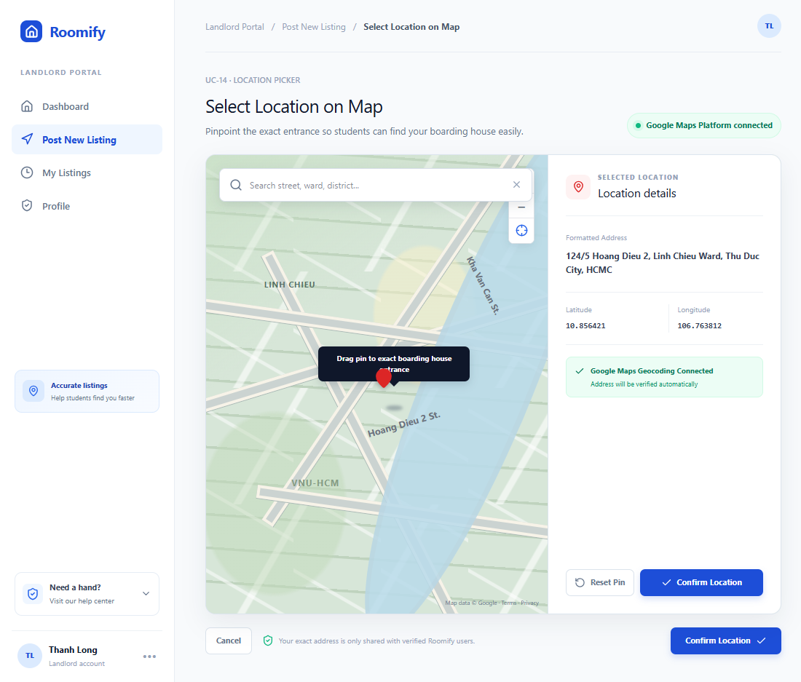  
*Figure UC-14: UI Prototype for Select Location on Map*

---

## UC-15: View My Listings

*Performed by: Đỗ Quốc Đại | Reviewed by: Võ Minh Khang | Edited by: Đỗ Quốc Đại*

### 1. Use-Case Name – UC-15: View My Listings

#### 1.1 Brief Description
This use case allows a logged-in Landlord to view and monitor all boarding house listings they have created, across all moderation statuses (**Pending**, **Approved**, and **Rejected**). From this screen, the Landlord can check rejection reasons from Admins and initiate editing (**UC-16**) or deleting (**UC-17**) a listing.

### 2. Flow of Events

#### 2.1 Basic Flow
This use case begins when the Landlord navigates to their listing management page.

1. The Landlord clicks **My Listings** on the navigation sidebar.
2. The system queries the database for all listings created by the logged-in Landlord, ordered by the most recently updated date.
3. The system displays the **My Listings** page, including:
   * Summary counters for **Total**, **Approved**, **Pending**, and **Rejected** listings.
   * Status filter tabs (**All**, **Approved**, **Pending**, **Rejected**) and a keyword search bar.
   * A list/table of the Landlord's listings showing: thumbnail image, title, address, monthly rent (VND), submission/update date, moderation **Status Badge**, and action buttons (**Edit**, **Delete**).
4. For any listing with status **Rejected**, the system displays the Admin's rejection reason note directly on the listing item.
5. The Landlord optionally selects a status filter tab or enters a keyword to filter their listings.
6. The system updates the displayed list to show only the matching listings. The use case ends.

#### 2.2 Alternative Flows

##### 2.2.1 2a. Landlord Has No Listings
If at step 2 of the Basic Flow, the Landlord has not created any listings yet:
1. The system displays an empty-state illustration with the message: *"You have not posted any boarding house listings yet."*
2. The system displays a **Post New Listing** button that links directly to **UC-13 (Post Listing)**. The use case ends.

##### 2.2.2 5a. No Listings Match Selected Filter or Keyword
If at step 5 of the Basic Flow, no listings owned by the Landlord match the selected status tab or search keyword:
1. The system displays the message: *"No listings match the selected filter."* along with a **Reset Filter** button.
2. If the Landlord clicks **Reset Filter**, the system restores the full list of the Landlord's listings (step 3).

### 3. Special Requirements

#### 3.1 Ownership Isolation
* A Landlord must only be able to view listings that belong to their own account; listings belonging to other Landlords must never be returned in this view.

### 4. Preconditions

#### 4.1 Authenticated Landlord
* The user is logged into the system with the **Landlord** role.

### 5. Postconditions

#### 5.1 Success Postcondition
* The Landlord's listings and their current moderation statuses (**Pending**, **Approved**, **Rejected**) are accurately displayed.

#### 5.2 Failure Postcondition
* If a system error occurs, an error notification is displayed and no data is modified.

### 6. Extension Points
* None.

### 7. UI Prototype

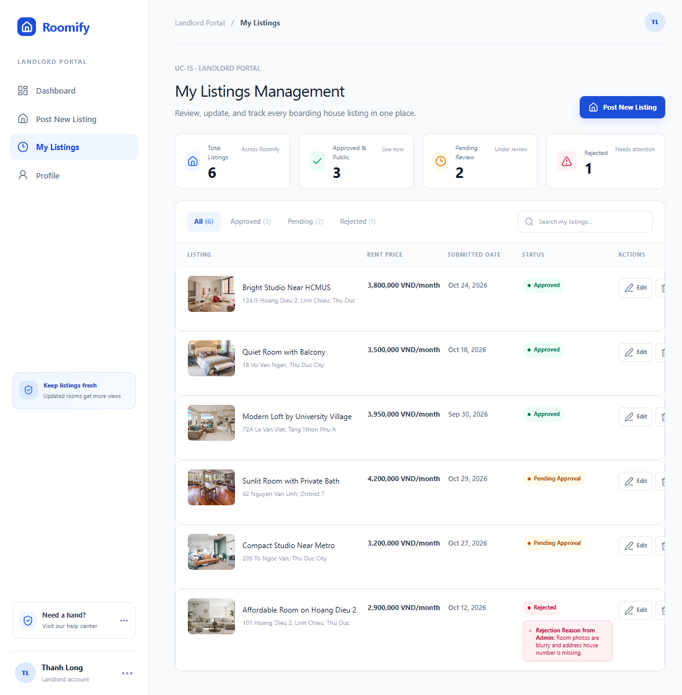  
*Figure UC-15: UI Prototype for View My Listings*

---

## UC-16: Edit Listing

*Performed by: Đỗ Quốc Đại | Reviewed by: Võ Minh Khang | Edited by: Đỗ Quốc Đại*

### 1. Use-Case Name – UC-16: Edit Listing

#### 1.1 Brief Description
This use case allows a Landlord to update the information, photos, or location of an existing listing they own. In accordance with Roomify's moderation policy, editing a listing—including one that was previously **Approved** or **Rejected**—resets its status to **Pending** so that an Admin can review the updated content before it is shown publicly.

### 2. Flow of Events

#### 2.1 Basic Flow
This use case begins when the Landlord selects a listing to edit from **UC-15 (View My Listings)**.

1. On the **My Listings** page (**UC-15**), the Landlord clicks the **Edit** button on a specific listing.
2. The system retrieves the current listing data from the database and displays the **Edit Listing Form** pre-populated with the existing title, description, monthly rent, deposit, area ($\text{m}^2$), occupancy, amenities, map location, and uploaded photos.
3. The system displays a notice banner informing the Landlord that saving changes to an **Approved** listing will return its status to **Pending** for Admin re-approval.
4. The Landlord modifies the desired fields (such as updating the rent price, editing the description, adding/removing photos, or updating the map pin via **UC-14**).
5. The Landlord clicks the **Save & Resubmit** button.
6. The system validates all modified fields and uploaded photos.
7. The system saves the updated listing details in the database, sets the listing's moderation status to **Pending**, clears any previous rejection note, and removes the listing from public search results until re-approved.
8. The system displays a confirmation message (*"Listing updated successfully and submitted for administrator approval"*) and redirects the Landlord to **UC-15 (View My Listings)**. The use case ends.

#### 2.2 Alternative Flows

##### 2.2.1 6a. Validation Error on Edited Fields
If at step 6 of the Basic Flow, any required field is cleared, numeric values (price, area) are invalid ($\le 0$), or all photos are removed:
1. The system highlights the invalid fields in red and displays specific error messages.
2. The use case resumes at step 4 of the Basic Flow.

##### 2.2.2 5a. Landlord Cancels Editing
If at any point before clicking **Save & Resubmit**, the Landlord clicks **Discard Changes** or **Cancel**:
1. The system prompts the Landlord to confirm discarding unsaved modifications.
2. Upon confirmation, the system leaves the existing listing record and its current status (**Approved**, **Pending**, or **Rejected**) unchanged in the database and returns to **UC-15**. The use case ends.

##### 2.2.3 6b. No Changes Made
If at step 6 of the Basic Flow, the Landlord clicks **Save & Resubmit** without modifying any field or photo:
1. The system detects that no changes were made, preserves the listing's current status without resetting it to **Pending**, and returns the Landlord to **UC-15**. The use case ends.

### 3. Special Requirements

#### 3.1 Re-Approval Business Rule
* Editing an **Approved** listing must automatically transition its status back to **Pending** so that unverified changes cannot bypass Admin moderation.

### 4. Preconditions

#### 4.1 Authenticated Landlord and Listing Ownership
* The Landlord is logged in and is the owner of the selected listing.

### 5. Postconditions

#### 5.1 Success Postcondition
* The listing record is updated in the database and its status is set to **Pending**.

#### 5.2 Failure Postcondition
* The listing's previous data and moderation status remain unchanged.

### 6. Extension Points
* None.

### 7. UI Prototype

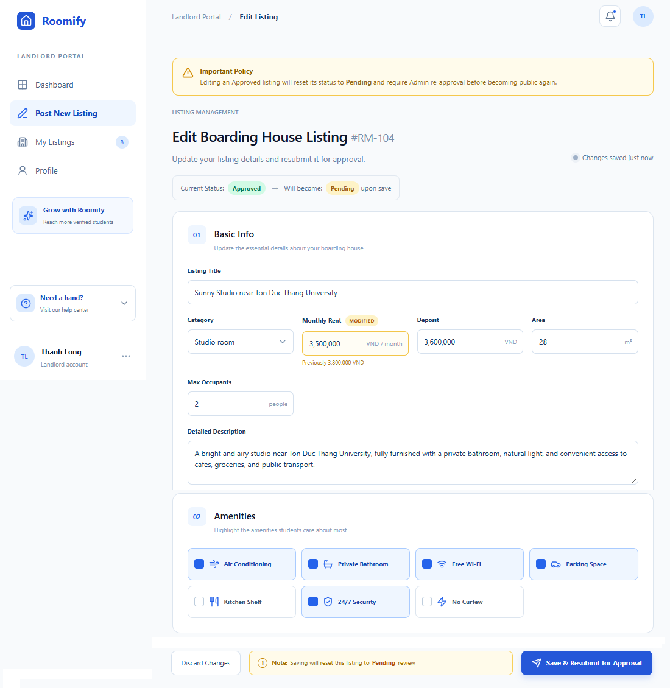  
*Figure UC-16: UI Prototype for Edit Listing*

---

## UC-17: Delete Listing

*Performed by: Đỗ Quốc Đại | Reviewed by: Võ Minh Khang | Edited by: Đỗ Quốc Đại*

### 1. Use-Case Name – UC-17: Delete Listing

#### 1.1 Brief Description
This use case allows a Landlord to permanently remove one of their boarding house listings from the Roomify system. Once deleted, the listing is removed from the Landlord's dashboard, public search results, map views, and Tenants' favorite lists.

### 2. Flow of Events

#### 2.1 Basic Flow
This use case begins when the Landlord chooses to delete a listing from **UC-15 (View My Listings)**.

1. On the **My Listings** page (**UC-15**), the Landlord clicks the **Delete** button next to the target listing.
2. The system displays a **Delete Listing Confirmation Modal** showing the listing title and warning: *"Are you sure you want to permanently delete this listing? This action cannot be undone."*
3. The Landlord clicks the **Confirm Delete** button.
4. The system verifies that the logged-in Landlord owns the listing and deletes the listing record (along with its associated nearby-place records and favorite references) from the database.
5. The system closes the confirmation modal, removes the listing from the **My Listings** view, and displays a success toast notification: *"Listing deleted successfully."* The use case ends.

#### 2.2 Alternative Flows

##### 2.2.1 3a. Landlord Cancels Deletion
If at step 3 of the Basic Flow, the Landlord clicks the **Cancel** button or closes the confirmation modal:
1. The system closes the modal without deleting the listing.
2. The listing remains unchanged in **My Listings**. The use case ends.

##### 2.2.2 4a. System Error During Deletion
If at step 4 of the Basic Flow, a database or network error prevents the deletion from completing:
1. The system rolls back the transaction so the listing remains intact.
2. The system displays an error message: *"Unable to delete listing at this time. Please try again later."* The use case ends.

### 3. Special Requirements

#### 3.1 Cascade Clean-Up
* Deleting a listing must automatically remove associated saved entries in Tenants' favorite lists (**UC-10**) and stored nearby-place records (**UC-21**) so no broken references remain.

### 4. Preconditions

#### 4.1 Authenticated Landlord and Listing Ownership
* The Landlord is logged in, is viewing **UC-15 (View My Listings)**, and owns the listing selected for deletion.

### 5. Postconditions

#### 5.1 Success Postcondition
* The listing is permanently removed from the system and is no longer accessible in any search, map, favorite, or management view.

#### 5.2 Failure Postcondition
* The listing remains intact in the database.

### 6. Extension Points
* None.

### 7. UI Prototype

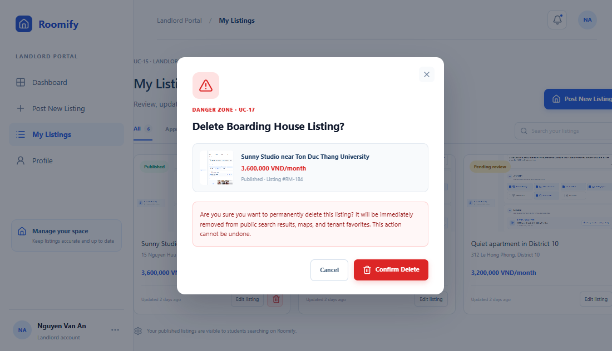  
*Figure UC-17: UI Prototype for Delete Listing*

---

## UC-18: Review Pending Listings

*Performed by: Đỗ Quốc Đại | Reviewed by: Võ Minh Khang | Edited by: Đỗ Quốc Đại*

### 1. Use-Case Name – UC-18: Review Pending Listings

#### 1.1 Brief Description
This use case allows an Admin to browse the queue of boarding house listings with status **Pending** and inspect the full details of a selected listing (photos, pricing, description, landlord contact details, and pinned map location) to verify its quality and authenticity before deciding whether to approve (**UC-19**) or reject (**UC-20**) it.

### 2. Flow of Events

#### 2.1 Basic Flow
This use case begins when the Admin opens the listing moderation workspace.

1. The Admin clicks **Moderation Queue** (or **Review Pending Listings**) on the Admin navigation sidebar.
2. The system queries the database for all listings currently in **Pending** status, ordered by submission timestamp (oldest first), and displays the **Pending Listings Queue**.
3. For each pending listing in the queue, the system displays the listing ID, title, Landlord name, submitted date, monthly rent, and an **Inspect** button.
4. The Admin selects a pending listing from the queue to review.
5. The system displays the **Listing Inspection Panel** containing the complete listing details:
   * Uploaded room photos gallery
   * Title, description, monthly rent, deposit, area ($\text{m}^2$), and maximum occupancy
   * Selected amenities
   * Landlord profile and contact information
   * Interactive map preview showing the pinned address and coordinates (`latitude`, `longitude`)
6. The Admin inspects the listing content against platform guidelines. At this point (*Extension Point: Moderation Decision*), the Admin can either approve the listing (**UC-19**) or reject the listing (**UC-20**). The use case ends.

#### 2.2 Alternative Flows

##### 2.2.1 2a. No Pending Listings Available
If at step 2 of the Basic Flow, there are no listings with status **Pending**:
1. The system displays an empty-queue state with the message: *"All caught up! There are currently no pending listings awaiting review."* The use case ends.

##### 2.2.2 6a. Admin Leaves Inspection Without Making a Decision
If at step 6 of the Basic Flow, the Admin selects another listing or navigates away without clicking **Approve** or **Reject**:
1. The system keeps the current listing's status as **Pending** and displays the newly selected screen. The use case ends.

### 3. Special Requirements

#### 3.1 Role-Based Access Control
* Only authenticated users with the **Admin** role are permitted to view and inspect listings in the **Pending** moderation queue.

### 4. Preconditions

#### 4.1 Authenticated Admin
* The user is logged into the system with the **Admin** role.

### 5. Postconditions

#### 5.1 Success Postcondition
* The pending listing queue and the full details of the selected pending listing are displayed to the Admin, ready for a moderation decision (**UC-19** or **UC-20**).

#### 5.2 Failure Postcondition
* The moderation states of all listings remain unchanged.

### 6. Extension Points

#### 6.1 Approve Listing Decision
* At step 6 of the Basic Flow, if the Admin determines that the listing is valid and complete, **UC-19 (Approve Listing)** is triggered when the Admin clicks **Approve Listing**.

#### 6.2 Reject Listing Decision
* At step 6 of the Basic Flow, if the Admin determines that the listing is inaccurate, incomplete, or violates rules, **UC-20 (Reject Listing)** is triggered when the Admin clicks **Reject Listing**.

### 7. UI Prototype

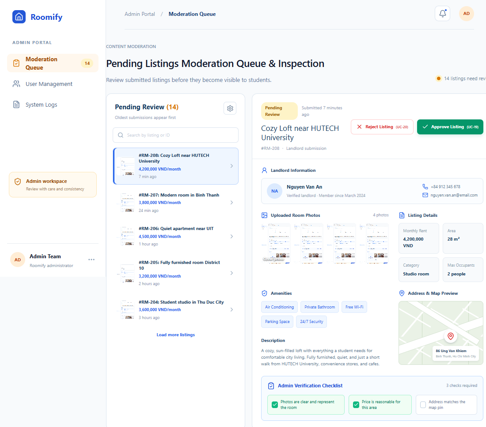  
*Figure UC-18: UI Prototype for Review Pending Listings*

---

## UC-19: Approve Listing

*Performed by: Đỗ Quốc Đại | Reviewed by: Võ Minh Khang | Edited by: Đỗ Quốc Đại*

### 1. Use-Case Name – UC-19: Approve Listing

#### 1.1 Brief Description
This use case extends **UC-18 (Review Pending Listings)** when an Admin approves a pending listing. Approving a listing automatically triggers **UC-21 (Retrieve Nearby Information)** to fetch and store nearby schools and Bach Hoa Xanh stores from the Google Maps Platform, changes the listing status to **Approved**, and publishes the listing to all public search, map, and AI recommendation views.

### 2. Flow of Events

#### 2.1 Basic Flow
This use case begins at the *Approve Listing Decision* extension point (step 6 of **UC-18**) when the Admin decides to approve the inspected pending listing.

1. The Admin clicks the **Approve Listing** button in the Listing Inspection Panel.
2. The system displays an **Approve Listing Confirmation Dialog** summarizing the listing title and noting that nearby schools and Bach Hoa Xanh stores will be automatically fetched and stored.
3. The Admin clicks **Confirm & Approve**.
4. The system executes **UC-21 (Retrieve Nearby Information)** to fetch and store nearby schools/universities and Bach Hoa Xanh stores for the listing's coordinates.
5. The system updates the listing's status from **Pending** to **Approved**, records the approval timestamp and Admin ID, and makes the listing publicly visible in **UC-06 (Search Listings with Filters)**, **UC-07 (View Listings on Map)**, and **UC-12 (Get Listing Recommendations)**.
6. The system displays a success notification (*"Listing approved, enriched with nearby places, and published!"*) and removes the listing from the pending moderation queue in **UC-18**. The use case ends.

#### 2.2 Alternative Flows

##### 2.2.1 3a. Admin Cancels Approval
If at step 3 of the Basic Flow, the Admin clicks **Cancel** in the confirmation dialog:
1. The system closes the dialog without changing the listing's status.
2. Control returns to step 6 of **UC-18 (Review Pending Listings)**.

##### 2.2.2 4a. Nearby Information Retrieval Fails During Approval
If at step 4 of the Basic Flow, **UC-21 (Retrieve Nearby Information)** encounters a temporary Google Maps API error:
1. The system still updates the listing status to **Approved** (or flags `nearby_data_status = Pending_Retry`) so moderation is not blocked.
2. The system displays a warning message to the Admin: *"Listing approved, but nearby places could not be fetched right now. You can click Re-sync Nearby Info to retry."* The use case ends.

##### 2.2.3 5a. Listing Already Moderated by Another Admin
If at step 5 of the Basic Flow, the system detects that the listing status is no longer **Pending** (because another Admin already approved or rejected it):
1. The system aborts the update, notifies the Admin (*"This listing has already been reviewed by another administrator"*), and refreshes the pending queue. The use case ends.

### 3. Special Requirements

#### 3.1 Automatic One-Time Nearby Enrichment
* Every listing approval must invoke **UC-21** so that nearby place data is pre-computed and stored in the database once upon approval, avoiding repeated external API calls when Tenants view listing details (**UC-08**).

### 4. Preconditions

#### 4.1 Inspected Pending Listing
* The Admin is logged in, is inspecting a listing in **UC-18**, and the listing currently has status **Pending**.

### 5. Postconditions

#### 5.1 Success Postcondition
* The listing status is updated to **Approved**, nearby place data from **UC-21** is stored with the listing, and the listing becomes publicly searchable.

#### 5.2 Failure Postcondition
* The listing remains in **Pending** status and is not visible to the public.

### 6. Extension Points
* None.

### 7. UI Prototype

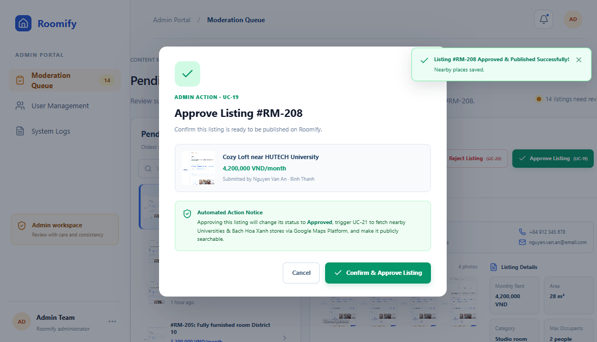  
*Figure UC-19: UI Prototype for Approve Listing*

---

## UC-20: Reject Listing

*Performed by: Đỗ Quốc Đại | Reviewed by: Võ Minh Khang | Edited by: Đỗ Quốc Đại*

### 1. Use-Case Name – UC-20: Reject Listing

#### 1.1 Brief Description
This use case extends **UC-18 (Review Pending Listings)** when an Admin determines that a pending listing violates platform standards (such as inaccurate map location, blurry photos, misleading pricing, or incomplete information). The Admin records a mandatory rejection reason and changes the listing status to **Rejected** so the Landlord can review the feedback and fix the listing.

### 2. Flow of Events

#### 2.1 Basic Flow
This use case begins at the *Reject Listing Decision* extension point (step 6 of **UC-18**) when the Admin decides to reject the inspected pending listing.

1. The Admin clicks the **Reject Listing** button in the Listing Inspection Panel.
2. The system displays the **Reject Listing Modal**, containing predefined violation categories (e.g., *Blurry/Misleading Photos*, *Address/Map Mismatch*, *Unrealistic Pricing*, *Duplicate/Spam*) and a required **Detailed Feedback for Landlord** text area.
3. The Admin selects one or more violation categories, enters a clear explanation in the feedback text area, and clicks the **Confirm Rejection** button.
4. The system validates that a rejection reason has been provided.
5. The system updates the listing's status from **Pending** to **Rejected** and saves the rejection reason, Admin ID, and timestamp in the database.
6. The system closes the modal, displays a confirmation message (*"Listing has been rejected and feedback has been sent to the Landlord"*), and removes the listing from the pending queue in **UC-18**. The use case ends.

#### 2.2 Alternative Flows

##### 2.2.1 4a. Missing Rejection Reason
If at step 4 of the Basic Flow, the Admin clicks **Confirm Rejection** without selecting a reason or entering feedback text:
1. The system highlights the feedback field in red and displays an error message: *"A rejection reason is required so the Landlord knows how to correct the listing."*
2. The use case resumes at step 3 of the Basic Flow.

##### 2.2.2 3a. Admin Cancels Rejection
If at step 3 of the Basic Flow, the Admin clicks **Cancel** or closes the modal:
1. The system discards the entered rejection note, closes the modal, and leaves the listing in **Pending** status.
2. Control returns to step 6 of **UC-18 (Review Pending Listings)**.

### 3. Special Requirements

#### 3.1 Mandatory Rejection Feedback
* The system must not allow a listing to be rejected without a non-empty rejection reason (minimum $10$ characters), ensuring transparency for the Landlord in **UC-15 (View My Listings)**.

### 4. Preconditions

#### 4.1 Inspected Pending Listing
* The Admin is logged in, is inspecting a listing in **UC-18**, and the listing currently has status **Pending**.

### 5. Postconditions

#### 5.1 Success Postcondition
* The listing status is set to **Rejected**, the rejection reason is saved and visible to the Landlord in **UC-15**, and the listing remains hidden from public views.

#### 5.2 Failure Postcondition
* The listing remains in **Pending** status.

### 6. Extension Points
* None.

### 7. UI Prototype

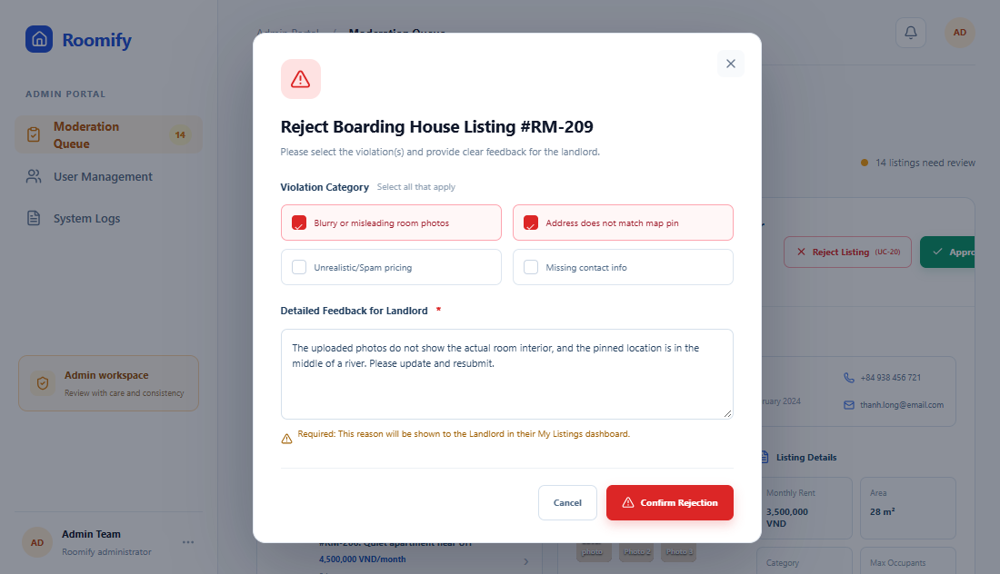  
*Figure UC-20: UI Prototype for Reject Listing*

---

## UC-21: Retrieve Nearby Information

*Performed by: Đỗ Quốc Đại | Reviewed by: Võ Minh Khang | Edited by: Đỗ Quốc Đại*

### 1. Use-Case Name – UC-21: Retrieve Nearby Information

#### 1.1 Brief Description
This use case is automatically included when an Admin approves a listing in **UC-19 (Approve Listing)**. Using the listing's geographic coordinates, the system queries the **Google Maps Platform** to discover nearby schools/universities and **Bach Hoa Xanh** grocery stores within a configured radius, calculates their distances from the boarding house, and stores this information in the database for fast display in **UC-08 (View Listing Details)**.

### 2. Flow of Events

#### 2.1 Basic Flow
This use case begins when **UC-19 (Approve Listing)** invokes nearby-place data retrieval for the listing being approved (or when an Admin clicks **Re-sync Nearby Data**).

1. The system retrieves the verified `latitude` and `longitude` coordinates of the listing.
2. The system sends a nearby-places search request to the **Google Maps Platform** (Places API) within a configured radius (default $2.0\text{ km}$) targeting two categories:
   * **Schools and Universities** (`university`, `school`)
   * **Bach Hoa Xanh Grocery Stores** (keyword `"Bach Hoa Xanh"`)
3. The **Google Maps Platform** returns lists of matching nearby points of interest, including place name, address, coordinates, and place ID.
4. The system calculates the distance (in kilometers) from the boarding house to each returned place, sorts the results by proximity, and selects the closest entries for each category.
5. The system saves the structured nearby-places records (place name, category, address, distance in $\text{km}$, and retrieval timestamp) in the database linked to the listing ID.
6. The system displays the retrieved nearby schools and Bach Hoa Xanh stores in the **Nearby Information Verification Panel** and returns control to **UC-19**. The use case ends.

#### 2.2 Alternative Flows

##### 2.2.1 3a. No Nearby Schools or Bach Hoa Xanh Found Within Radius
If at step 3 of the Basic Flow, the **Google Maps Platform** returns zero results for one or both categories within the $2.0\text{ km}$ radius:
1. The system records an empty nearby list for that category (with status *"No locations found within 2.0 km"*) in the database so **UC-08** can inform Tenants accurately.
2. The use case continues to step 6 of the Basic Flow.

##### 2.2.2 2a. Google Maps Platform API Failure or Timeout
If at step 2 or 3 of the Basic Flow, the **Google Maps Platform** is unreachable, times out, or returns an API quota error:
1. The system logs the API error details and marks the listing's nearby-information sync status as **Pending Sync**.
2. The system provides a **Re-sync Nearby Data** button on the Admin panel so the Admin can trigger **UC-21** again once connectivity is restored, and returns control to **UC-19**. The use case ends.

### 3. Special Requirements

#### 3.1 Persist-Once Read-Many Architecture
* Nearby place data must be persisted in the Roomify database during **UC-21** so that **UC-08 (View Listing Details)** reads directly from the local database without calling the Google Maps API on every page view.

### 4. Preconditions

#### 4.1 Valid Listing Coordinates
* The target listing has valid `latitude` and `longitude` coordinates stored in the database.

### 5. Postconditions

#### 5.1 Success Postcondition
* The database stores the list of nearby schools/universities and Bach Hoa Xanh stores (with distances in $\text{km}$) associated with the approved listing.

#### 5.2 Failure Postcondition
* The listing's nearby-data sync flag is marked for retry, and no corrupted place records are saved.

### 6. Extension Points
* None.

### 7. UI Prototype

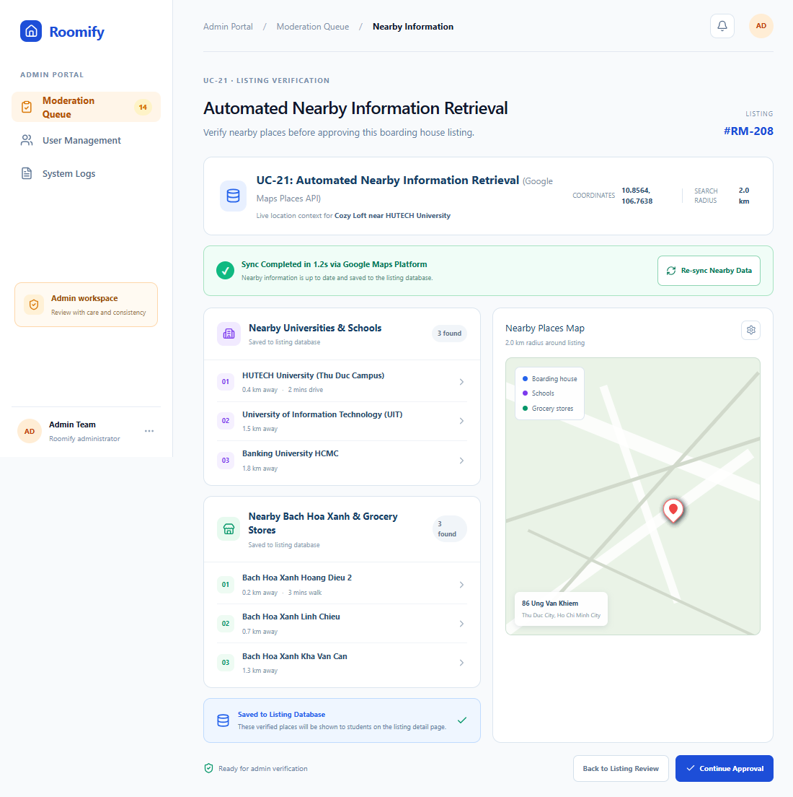  
*Figure UC-21: UI Prototype for Retrieve Nearby Information*

---

## UC-22: Manage User Accounts

*Performed by: Đỗ Quốc Đại | Reviewed by: Võ Minh Khang | Edited by: Đỗ Quốc Đại*

### 1. Use-Case Name – UC-22: Manage User Accounts

#### 1.1 Brief Description
This use case enables an Admin to view, search, filter, and manage registered user accounts (**Tenants**, **Landlords**, and **Admins**). The Admin can lock (suspend) accounts that violate platform policies, unlock previously suspended accounts, or update user roles.

### 2. Flow of Events

#### 2.1 Basic Flow
This use case begins when the Admin navigates to the user account management screen.

1. The Admin clicks **User Management** on the Admin navigation sidebar.
2. The system queries the database for registered user accounts and displays the **User Accounts Management** page, including:
   * Summary metric cards (**Total Users**, **Tenants**, **Landlords**, **Locked Accounts**)
   * A search bar (by name, email, or phone number) and filter dropdowns for **Role** (`All`, `Tenant`, `Landlord`, `Admin`) and **Status** (`All`, `Active`, `Locked`)
   * A paginated user table showing: User ID, Full Name, Email, Phone Number, Role badge, Registration Date, Account Status badge (`Active` or `Locked`), and action buttons (**Change Role**, **Lock / Unlock**)
3. The Admin optionally searches or filters the table to locate a specific user account.
4. The Admin clicks an action button on a target user row (for example, clicking **Lock** on a Landlord account that repeatedly posts spam, or clicking **Unlock** on a suspended account, or selecting a new role).
5. The system displays a confirmation dialog asking the Admin to confirm the action (and enter a reason if locking an account).
6. The Admin enters the reason (if applicable) and clicks **Confirm**.
7. The system updates the user account's status or role in the database, invalidates active sessions if the account was locked, and refreshes the user table with a success message: *"User account updated successfully."* The use case ends.

#### 2.2 Alternative Flows

##### 2.2.1 4a. Admin Attempts to Lock or Demote Own Account
If at step 4 of the Basic Flow, the Admin attempts to lock their own currently logged-in account or remove their own **Admin** role:
1. The system blocks the operation and displays an error message: *"Action denied: You cannot lock or remove administrator privileges from your own account."*
2. The use case resumes at step 2 of the Basic Flow.

##### 2.2.2 3a. No User Accounts Match Search or Filter Criteria
If at step 3 of the Basic Flow, no user records match the entered search keyword or selected filters:
1. The system displays an empty table state with the message: *"No user accounts found matching your criteria"* and a **Clear Filters** button.
2. If the Admin clicks **Clear Filters**, the system restores the default user list (step 2).

##### 2.2.3 6a. Admin Cancels Account Action
If at step 6 of the Basic Flow, the Admin clicks **Cancel** in the confirmation dialog:
1. The system closes the dialog and leaves the user account's status and role unchanged. The use case ends.

### 3. Special Requirements

#### 3.1 Immediate Session Revocation on Lock
* When an account's status is changed to **Locked**, the system must immediately revoke any active authentication tokens for that user so they cannot post listings or log in (**UC-02**) until unlocked by an Admin.

### 4. Preconditions

#### 4.1 Authenticated Admin
* The user is logged into the system with the **Admin** role.

### 5. Postconditions

#### 5.1 Success Postcondition
* The target user's account status (`Active` / `Locked`) or role (`Tenant` / `Landlord` / `Admin`) is updated in the database and reflected in the UI.

#### 5.2 Failure Postcondition
* The user account record remains unchanged in the database.

### 6. Extension Points
* None.

### 7. UI Prototype

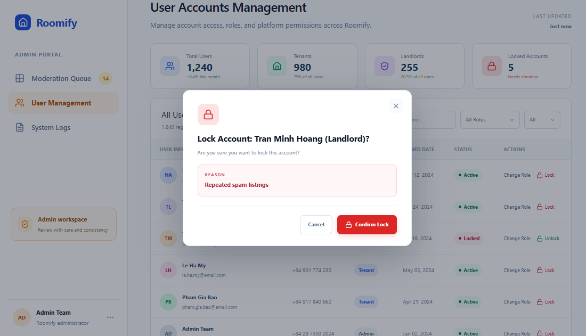  
*Figure UC-22: UI Prototype for Manage User Accounts*

## UC-23: Submit Landlord Request

*Performed by: Từ Thái Hưng | Reviewed by: Võ Minh Khang | Edited by: Từ Thái Hưng*

### 1. Use-Case Name – UC-23: Submit Landlord Request

#### 1.1 Brief Description
This use case allows a logged-in Registered User (who does not yet have Landlord rights) to submit a formal request to become a Landlord on Roomify. The user provides identity verification details and documents, which are then queued for Admin review (UC-24).

### 2. Flow of Events

#### 2.1 Basic Flow
This use case begins when a Registered User decides to upgrade their account to a Landlord role.

1. The Registered User navigates to the "Trở thành Chủ trọ" (Become a Landlord) page from the navigation menu or dashboard.
2. The system displays the Landlord Request Form, requesting identity verification details (Phone Number, Citizen ID/CCCD number, Permanent Address) and file uploads for the front and back photos of their Citizen ID.
3. The user enters valid information, uploads the required photos, and clicks the "Gửi yêu cầu" (Submit Request) button.
4. The system validates the input formats and checks that the uploaded files meet size and format constraints.
5. The system verifies that the user does not already have an active or pending Landlord request.
6. The system saves the request in the database with a "Pending" status.
7. The system displays a confirmation message indicating that the request has been submitted and is awaiting Admin review, and redirects the user back to the homepage. The use case ends.

#### 2.2 Alternative Flows

##### 2.2.1 4a. Missing or Invalid Input
If at step 4 of the Basic Flow, any required fields are blank, or the Citizen ID format is invalid:
1. The system highlights the invalid fields in red and displays an error message.
2. The use case resumes at step 3 of the Basic Flow.

##### 2.2.2 4b. Invalid File Upload
If at step 4 of the Basic Flow, the uploaded photos exceed the maximum file size (e.g., 5MB) or are in an unsupported format (not JPG/PNG):
1. The system rejects the file and displays an error message.
2. The use case resumes at step 3 of the Basic Flow.

##### 2.2.3 5a. Request Already Pending
If at step 5 of the Basic Flow, the system detects that the user already has a request in the "Pending" queue:
1. The system prevents submission and displays a message: "Bạn đã gửi yêu cầu trước đó. Vui lòng chờ quản trị viên phê duyệt." (You have already submitted a request. Please wait for admin approval). The use case ends.

### 3. Special Requirements

#### 3.1 Data Privacy
* Uploaded identity documents (Citizen ID photos) must be stored securely and only accessible by Admins during the review process.

### 4. Preconditions

#### 4.1 Account Status
* The user is authenticated and logged into the system as a Registered User.
* The user does not currently hold the Landlord role.

### 5. Postconditions

#### 5.1 Success Postcondition
* A new Landlord request is created in the database with a "Pending" status.

#### 5.2 Failure Postcondition
* No request is created, and the user's role remains unchanged.

### 6. Extension Points
* None.

### 7. UI Prototype

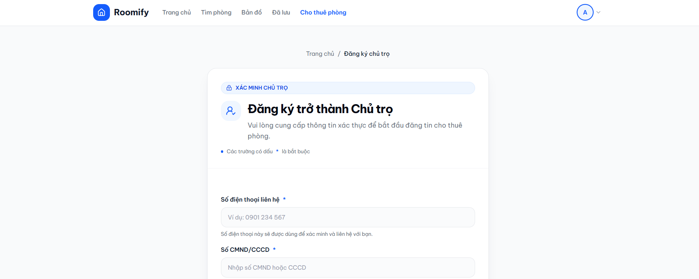  
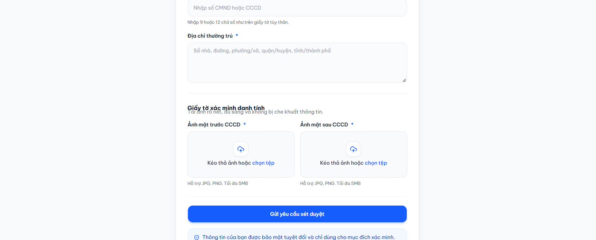  
*Figure UC-23: UI Prototype for Submit Landlord Request*

## UC-24: Review Landlord Requests

*Performed by: Từ Thái Hưng | Reviewed by: Võ Minh Khang | Edited by: Từ Thái Hưng*

### 1. Use-Case Name – UC-24: Review Landlord Requests

#### 1.1 Brief Description
This use case allows an Admin to browse the queue of pending Landlord requests, inspect the applicant's submitted identity verification details (Citizen ID photos, phone number, address), and decide whether to approve or reject the request.

### 2. Flow of Events

#### 2.1 Basic Flow
This use case begins when the Admin navigates to the landlord verification workspace.

1. The Admin clicks "Yêu cầu duyệt Chủ trọ" (Landlord Requests) on the Admin navigation sidebar.
2. The system queries the database and displays a queue of pending landlord requests, sorted by submission timestamp (oldest first).
3. The Admin selects a specific request from the queue to inspect.
4. The system displays the applicant's profile summary along with the submitted verification details (Phone Number, Citizen ID/CCCD number, Permanent Address) and the uploaded front and back photos of the Citizen ID.
5. The Admin reviews the provided documents for authenticity, clarity, and consistency. At this point (*Extension Point: Moderation Decision*), the Admin can either approve the request (**UC-25**) or reject it (**UC-26**). The use case ends.

#### 2.2 Alternative Flows

##### 2.2.1 2a. No Pending Requests Available
If at step 2 of the Basic Flow, there are no requests with a "Pending" status:
1. The system displays an empty-queue state with the message: "Hiện không có yêu cầu nào cần duyệt" (No pending requests to review). The use case ends.

##### 2.2.2 5a. Admin Leaves Inspection Without Making a Decision
If at step 5 of the Basic Flow, the Admin selects another request or navigates away without clicking Approve or Reject:
1. The system keeps the current request's status as "Pending" and displays the newly selected screen. The use case ends.

### 3. Special Requirements

#### 3.1 Role-Based Access Control
* Only authenticated users with the **Admin** role are permitted to view and inspect identity documents in the Landlord request queue.

### 4. Preconditions

#### 4.1 Authenticated Admin
* The user is logged into the system with the **Admin** role.

### 5. Postconditions

#### 5.1 Success Postcondition
* The pending landlord request queue and the full verification details of the selected applicant are displayed to the Admin, ready for a moderation decision (**UC-25** or **UC-26**).

#### 5.2 Failure Postcondition
* The moderation states of all requests remain unchanged.

### 6. Extension Points

#### 6.1 Approve Landlord Request Decision
* At step 5 of the Basic Flow, if the Admin determines that the identity documents are valid and match the user's information, **UC-25 (Approve Landlord Request)** is triggered when the Admin clicks "Phê duyệt" (Approve).

#### 6.2 Reject Landlord Request Decision
* At step 5 of the Basic Flow, if the Admin determines that the documents are invalid, blurry, or mismatched, **UC-26 (Reject Landlord Request)** is triggered when the Admin clicks "Từ chối" (Reject).

### 7. UI Prototype

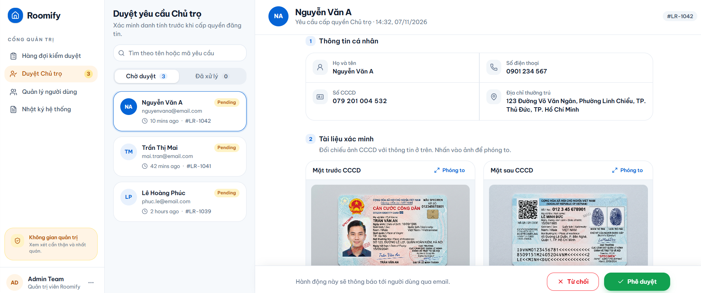  
*Figure UC-24: UI Prototype for Review Landlord Requests*

## UC-25: Approve Landlord Request

*Performed by: Từ Thái Hưng | Reviewed by: Võ Minh Khang | Edited by: Từ Thái Hưng*

### 1. Use-Case Name – UC-25: Approve Landlord Request

#### 1.1 Brief Description
This use case extends **UC-24 (Review Landlord Requests)**. It allows an Admin to approve a pending Landlord request, officially upgrading the applicant's account role from a standard Registered User to a Landlord.

### 2. Flow of Events

#### 2.1 Basic Flow
This use case begins at the *Approve Landlord Request Decision* extension point in **UC-24**.

1. The Admin clicks the "Phê duyệt" (Approve) button in the Inspection Panel for a selected pending request.
2. The system displays a confirmation modal summarizing the applicant's name and stating that they will be granted permission to post and manage listings.
3. The Admin clicks "Xác nhận cấp quyền" (Confirm Approval).
4. The system updates the user's account role to "Landlord" and marks the request status as "Approved" in the database.
5. The system displays a success notification ("Đã cấp quyền Chủ trọ thành công") and removes the request from the pending queue in **UC-24**. The use case ends.

#### 2.2 Alternative Flows

##### 2.2.1 3a. Admin Cancels Approval
If at step 3 of the Basic Flow, the Admin clicks "Hủy" (Cancel) or closes the modal:
1. The system closes the modal without changing the user's role or request status.
2. Control returns to step 5 of **UC-24**.

### 3. Special Requirements
* None.

### 4. Preconditions
* The Admin is inspecting a pending landlord request in **UC-24**.

### 5. Postconditions

#### 5.1 Success Postcondition
* The applicant is granted the Landlord role and the request is marked as Approved.

#### 5.2 Failure Postcondition
* The user's role and the request status remain unchanged.

### 6. Extension Points
* None.

### 7. UI Prototype

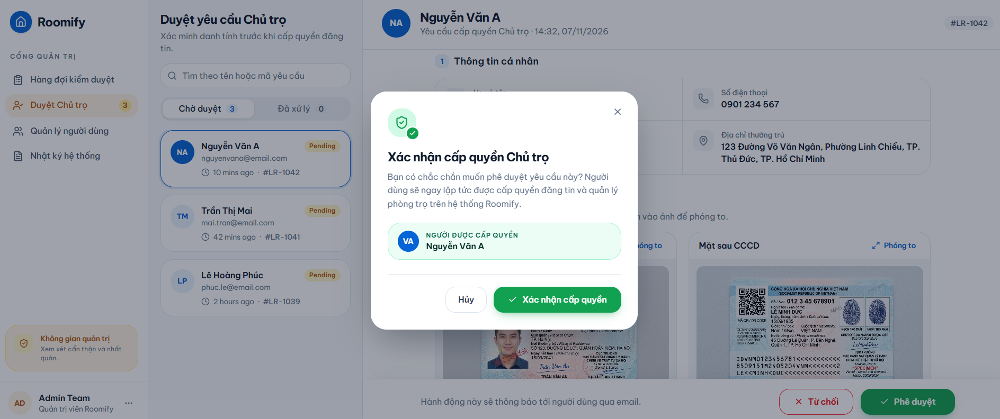  
*Figure UC-25: UI Prototype for Approve Landlord Request*

---

## UC-26: Reject Landlord Request

*Performed by: Từ Thái Hưng | Reviewed by: Võ Minh Khang | Edited by: Từ Thái Hưng*

### 1. Use-Case Name – UC-26: Reject Landlord Request

#### 1.1 Brief Description
This use case extends **UC-24 (Review Landlord Requests)**. It allows an Admin to reject a pending Landlord request due to invalid or mismatched identity documents, providing a mandatory reason for the rejection. 

### 2. Flow of Events

#### 2.1 Basic Flow
This use case begins at the *Reject Landlord Request Decision* extension point in **UC-24**.

1. The Admin clicks the "Từ chối" (Reject) button in the Inspection Panel for a selected pending request.
2. The system displays a Reject Request Modal containing a required "Lý do từ chối" (Reason for Rejection) text area.
3. The Admin enters a clear explanation detailing why the identity documents were not accepted and clicks "Xác nhận từ chối" (Confirm Rejection).
4. The system validates that the rejection reason is not empty.
5. The system updates the request status to "Rejected", saves the rejection reason, and keeps the user's role as a regular Registered User.
6. The system closes the modal, displays a confirmation message, and removes the request from the pending queue in **UC-24**. The use case ends.

#### 2.2 Alternative Flows

##### 2.2.1 4a. Missing Rejection Reason
If at step 4 of the Basic Flow, the Admin attempts to submit without entering a reason:
1. The system highlights the text area in red and requires input.
2. The use case resumes at step 3 of the Basic Flow.

##### 2.2.2 3a. Admin Cancels Rejection
If at step 3 of the Basic Flow, the Admin clicks "Hủy" (Cancel) or closes the modal:
1. The system discards the text, closes the modal, and leaves the request in "Pending" status.
2. Control returns to step 5 of **UC-24**.

### 3. Special Requirements

#### 3.1 Mandatory Feedback
* The Admin must provide a reason so the user knows what to fix in a future request.

### 4. Preconditions
* The Admin is inspecting a pending landlord request in **UC-24**.

### 5. Postconditions

#### 5.1 Success Postcondition
* The request is marked as Rejected with an attached reason. The user does not get the Landlord role from this request, but is permitted to submit a new request after correcting the issues.  

#### 5.2 Failure Postcondition
* The request remains Pending.

### 6. Extension Points
* None.

### 7. UI Prototype

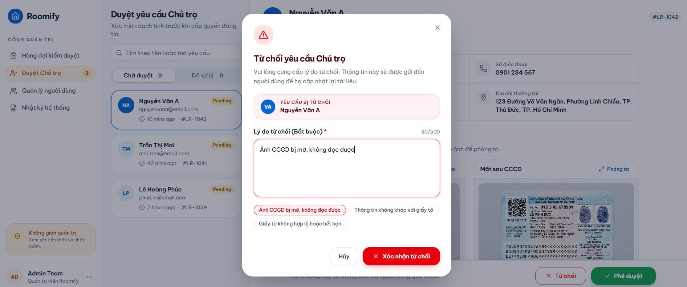  
*Figure UC-26: UI Prototype for Reject Landlord Request*