### UC-01: Register Account  

*Performed by: Từ Thái Hưng | Reviewed by: Võ Minh Khang | Edited by: Từ Thái Hưng*  

**1. Actor(s)**  
* Guest  

**2. Description**  
This use case allows a Guest to create a new account in the Roomify system to become a Registered User. The Guest can register using a standard Email/Password or via third-party social accounts (Google, Facebook). During this process, the user selects their primary role (Tenant or Landlord).  

**3. Preconditions**  
* The Guest has opened the Roomify web application and is not currently logged in.  

**4. Basic Flow (Main Success Scenario - Email Registration)**  
1. The Guest clicks on the "Register" button.  
2. The system displays the registration form requesting: Full Name, Email, Password, Confirm Password, and Role selection.  
3. The Guest enters valid information and clicks the "Đăng ký" (Submit) button.  
4. The system validates the input format (e.g., matching passwords, valid email format).  
5. The system verifies that the email does not already exist in the database.  
6. The system creates a new user account, securely hashes the password, and saves the data.  
7. The system redirects the user to the Login page.  

**5. Alternative Flows**  
* **5.1 Register with Google:** At step 2, the Guest clicks "Đăng ký bằng Google". The system redirects to the Google OAuth page. Upon successful authentication, the system prompts the user to select their Role, creates the account, and logs them in.  
* **5.2 Register with Facebook:** At step 2, the Guest clicks "Đăng ký bằng Facebook". The system redirects to the Facebook OAuth page. Upon successful authentication, the system prompts the user to select their Role, creates the account, and logs them in.  
* **5.3 Missing or Invalid Input:** At step 4, if fields are blank or invalid, the system displays an error message. The use case resumes at step 3.  
* **5.4 Passwords Do Not Match:** At step 4, if passwords do not match, the system displays an error message. The use case resumes at step 3.  
* **5.5 Email Already Exists:** At step 5, if the email is already registered, the system displays an error message. The use case resumes at step 3.  

**6. Postconditions**  
* A new user account (Tenant or Landlord) is successfully created.  

**7. Special Requirements**  
* User passwords must be securely hashed. OAuth flows must comply with Google and Facebook security standards.  

**8. UI Prototype**  

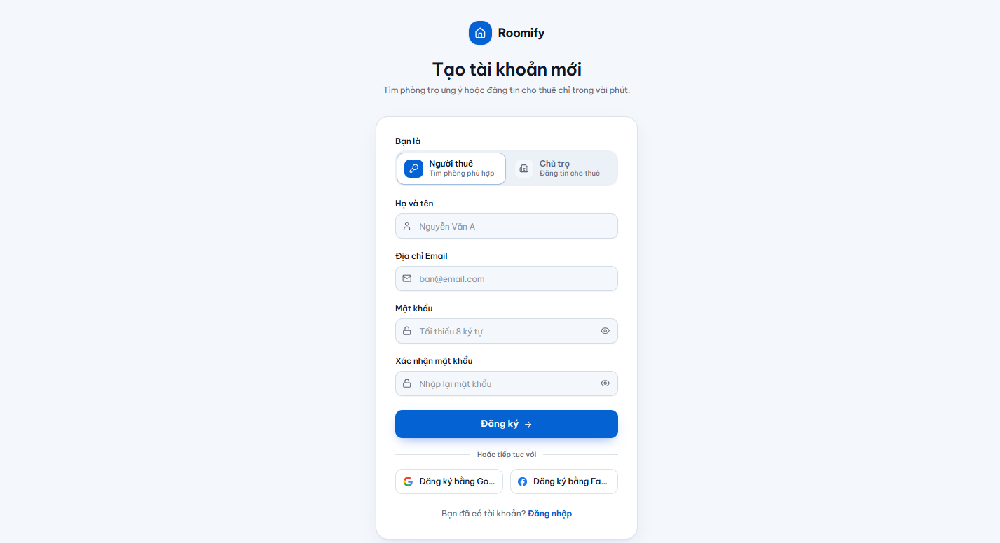

### UC-02: Log In  

*Performed by: Từ Thái Hưng | Reviewed by: Võ Minh Khang | Edited by: Từ Thái Hưng*  

**1. Actor(s)**  
* Guest  

**2. Description**  
This use case allows a Guest to authenticate and access the Roomify system using their registered Email or via third-party social accounts (Google, Facebook).  

**3. Preconditions**  
* The Guest has opened the Roomify web application and is not logged in.  

**4. Basic Flow (Main Success Scenario - Traditional Login)**  
1. The Guest clicks on the "Log In" button on the navigation bar.  
2. The system displays the login form.  
3. The Guest enters their registered Email and Password, then clicks the "Đăng nhập" button.  
4. The system validates the credentials against the database.  
5. The system authenticates the user, establishes a secure session, and redirects them to the homepage.  

**5. Alternative Flows**  
* **5.1 Log In with Google:** At step 3, the Guest clicks "Đăng nhập bằng Google". The system redirects to the Google OAuth page. Upon successful external authentication, the system logs the user in and redirects to the homepage.  
* **5.2 Log In with Facebook:** At step 3, the Guest clicks "Đăng nhập bằng Facebook". The system redirects to the Facebook OAuth page. Upon successful external authentication, the system logs the user in and redirects to the homepage.  
* **5.3 Invalid Credentials:** At step 4, if the input combination is incorrect, the system displays an error message. The use case resumes at step 3.  
* **5.4 Forgot Password:** At step 3, the Guest clicks "Quên mật khẩu?". The system triggers **UC-03 Reset Password**.  
* **5.5 Missing Input:** At step 3, if the Guest leaves required fields blank, the system prevents submission and highlights the fields. The use case resumes at step 3.  

**6. Postconditions**  
* The Guest is successfully authenticated and transitions to a Registered User state.  

**7. Special Requirements**  
* Passwords must be verified securely. OAuth flows must comply with Google and Facebook API security standards.  

**8. UI Prototype**  

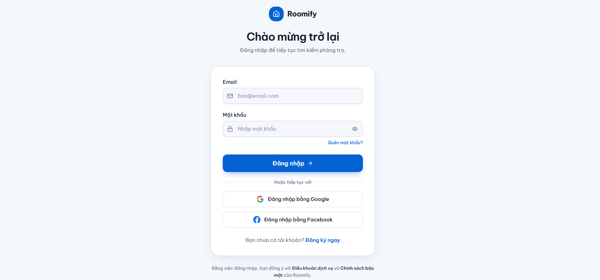

### UC-03: Reset Password  

*Performed by: Từ Thái Hưng | Reviewed by: Võ Minh Khang | Edited by: Từ Thái Hưng*  

**1. Actor(s)**  
* Guest  

**2. Description**  
This use case allows a Guest who has forgotten their password to reset it by requesting a password reset link sent to their registered email.  

**3. Preconditions**  
* The Guest is on the Login page.  

**4. Basic Flow (Main Success Scenario)**  
1. The Guest clicks on the "Quên mật khẩu?" (Forgot Password) link.  
2. The system displays the Reset Password form requesting the registered Email.  
3. The Guest enters their Email and clicks the "Gửi liên kết" (Send Link) button.  
4. The system validates that the Email exists in the database.  
5. The system generates a time-limited reset token and sends it to the Guest's email.  
6. The system displays a success message indicating the email has been sent.  

**5. Alternative Flows**  
* **5.1 Email Not Found:** At step 4, if the entered email is not registered, the system displays an error message. The use case resumes at step 3.  
* **5.2 Invalid Format:** At step 4, if the email format is invalid, the system displays a validation error. The use case resumes at step 3.  

**6. Postconditions**  
* A password reset link is successfully sent to the user.  

**7. Special Requirements**  
* Reset tokens must be securely generated and expire after a short period (e.g., 15 minutes).  

**8. UI Prototype**  

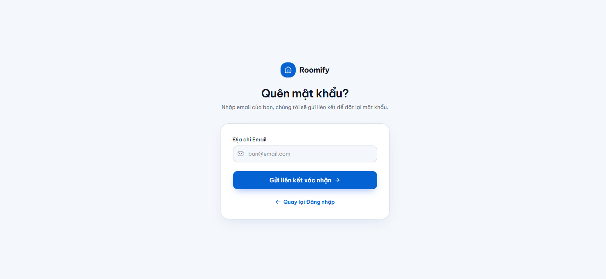

### UC-04: Log Out  

*Performed by: Từ Thái Hưng | Reviewed by: Võ Minh Khang | Edited by: Từ Thái Hưng*  

**1. Actor(s)**  
* Registered User (Tenant, Landlord, Administrator)  

**2. Description**  
This use case allows a logged-in user to securely end their active session in the Roomify system and return to the Guest state.  

**3. Preconditions**  
* The user is currently authenticated and logged into the Roomify application.  

**4. Basic Flow (Main Success Scenario)**  
1. The user clicks on their profile avatar or account menu on the top navigation bar.  
2. The system displays a dropdown menu with account options.  
3. The user selects the "Log Out" (Đăng xuất) option.  
4. The system terminates the active user session and clears all authentication tokens/cookies.  
5. The system redirects the user to the public homepage (or Login page) and updates the UI to show Guest options (Register/Log In).  

**5. Alternative Flows**  
* **5.1 Session Timeout:** If the user is inactive for a specified period, the system automatically terminates the session and logs the user out. The next time the user attempts to access a protected route, they are redirected to the Login page.  

**6. Postconditions**  
* The user's session is completely terminated.  
* The user loses access to role-specific features and protected pages.  

**7. Special Requirements**  
* **Security:** All session data and tokens (e.g., JWT) must be securely destroyed or invalidated on both the client and server sides to prevent session hijacking.  

**8. UI Prototype**  

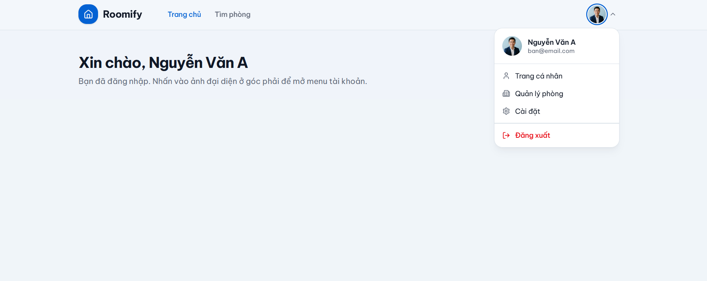

### UC-05: Manage Profile  

*Performed by: Từ Thái Hưng | Reviewed by: Võ Minh Khang | Edited by: Từ Thái Hưng*  

**1. Actor(s)**  
* Registered User (Tenant, Landlord, Admin)  

**2. Description**  
This use case allows a logged-in user to view and update their personal profile information, such as their full name, phone number, and avatar.  

**3. Preconditions**  
* The user is currently authenticated and logged into the Roomify system.  

**4. Basic Flow (Main Success Scenario)**  
1. The user navigates to the "Trang cá nhân" (Profile) page from the navigation menu.  
2. The system displays a form containing the user's current profile information (Avatar, Name, Email, Phone Number, and Role).  
3. The user modifies their editable details (e.g., uploads a new avatar, updates their phone number) and clicks the "Lưu thay đổi" (Save Changes) button.  
4. The system validates the input data (e.g., correct phone number format).  
5. The system updates the profile data in the database.  
6. The system displays a success notification and refreshes the displayed profile information.  

**5. Alternative Flows**  
* **5.1 Invalid Input:** At step 4, if the provided data is invalid (e.g., phone number contains letters), the system displays a validation error message next to the corresponding field. The use case resumes at step 3.  
* **5.2 Cancel Edit:** At step 3, if the user clicks "Hủy" (Cancel), the system discards any unsaved changes and reloads the original profile data. The use case ends.  

**6. Postconditions**  
* The user's profile information is successfully updated in the database and reflected across the UI (e.g., the avatar in the navigation bar).  

**7. Special Requirements**  
* The user's Email and Role are typically read-only and cannot be changed from this interface.  
* Avatar image uploads must be restricted by file size and format (e.g., max 2MB, JPG/PNG only).  

**8. UI Prototype**  

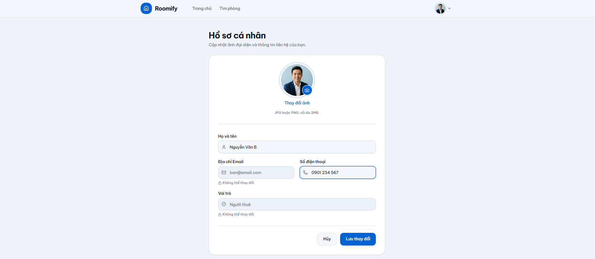

### UC-06: Search Listings with Filters  

*Performed by: Từ Thái Hưng | Reviewed by: Võ Minh Khang | Edited by: Từ Thái Hưng*  

**1. Actor(s)**  
* Guest  

**2. Description**  
This use case allows a Guest to search for available boarding house listings using keywords and apply various filters (such as price range, location, and amenities) to narrow down the results.  

**3. Preconditions**  
* The Guest has opened the Roomify web application.  

**4. Basic Flow (Main Success Scenario)**  
1. The Guest navigates to the Search page or uses the search bar on the homepage.  
2. The Guest enters search keywords (e.g., street name, district) into the search bar.  
3. The Guest selects specific filters in the filter panel (e.g., maximum price, property type, required amenities).  
4. The Guest clicks the "Áp dụng" (Apply) button.  
5. The system queries the database for approved listings that match all specified criteria.  
6. The system displays a paginated list or grid of the matching listings.  

**5. Alternative Flows**  
* **5.1 No Results Found:** At step 5, if no listings match the criteria, the system displays a friendly message indicating no results were found and suggests adjusting or clearing the filters. The use case resumes at step 3.  
* **5.2 Clear Filters:** At step 3, the Guest clicks a "Xóa bộ lọc" (Clear Filters) button. The system resets all filters to their default state and displays all available approved listings. The use case resumes at step 6.  

**6. Postconditions**  
* The system displays a list of listings that perfectly match the user's search criteria.  

**7. Special Requirements**  
* Search results must only include listings that have been officially approved by an Admin.  

**8. UI Prototype**  
*(Below is the UI prototype demonstrating the search interface and filter options).*  

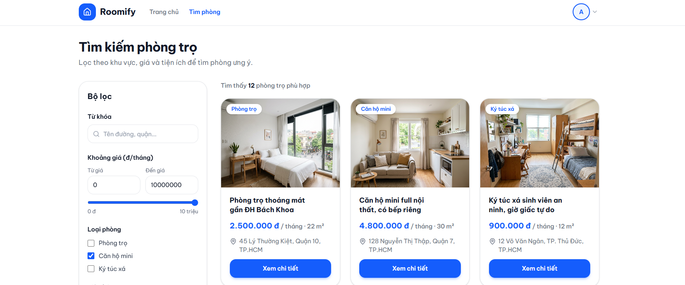
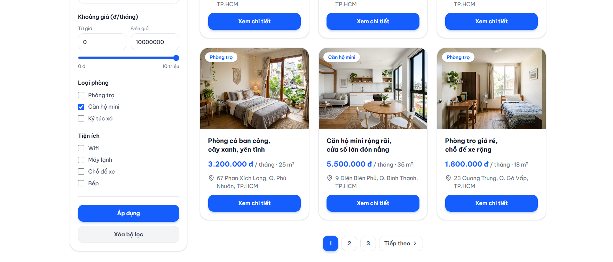

### UC-07: View Listings on Map  

*Performed by: Từ Thái Hưng | Reviewed by: Võ Minh Khang | Edited by: Từ Thái Hưng*  

**1. Actor(s)**  
* Guest (Primary)  
* Google Maps Platform (Secondary)  

**2. Description**  
This use case allows a Guest to view available boarding house listings on an interactive map. This provides a geographical overview of property locations and allows users to explore listings based on specific areas.  

**3. Preconditions**  
* The Guest has opened the Roomify web application.  

**4. Basic Flow (Main Success Scenario)**  
1. The Guest clicks the "Bản đồ" (Map view) toggle on the Search page.  
2. The system requests the map rendering interface from the Google Maps Platform.  
3. The system retrieves all approved listings and their geographical coordinates from the database.  
4. The system displays the interactive map with markers (pins) representing the available listings.  
5. The Guest clicks on a specific marker on the map.  
6. The system displays a pop-up window (Info Window) over the marker, showing a brief summary of the listing (thumbnail, price, title).  
7. The Guest clicks on the pop-up to view the full details of the listing.  
8. The system triggers **UC-08 View Listing Details**.  

**5. Alternative Flows**  
* **5.1 Google Maps API Failure:** At step 2, if the Google Maps Platform is unreachable or returns an error, the system displays a fallback error message (e.g., "Không thể tải bản đồ lúc này") and suggests the user switch back to the List view. The use case ends.  
* **5.2 Filter on Map:** At step 4, if the Guest applies filters via a floating filter panel, the system dynamically updates the map markers to display only the listings that match the new criteria. The use case resumes at step 4.  

**6. Postconditions**  
* The Guest successfully views the spatial distribution of the listings and can navigate to specific property details.  

**7. Special Requirements**  
* **Performance:** If there are too many listings in a specific area, the system should use marker clustering to maintain performance and map readability.  
* **External API:** Requires a valid API Key and connection to the Google Maps Platform.  

**8. UI Prototype**  

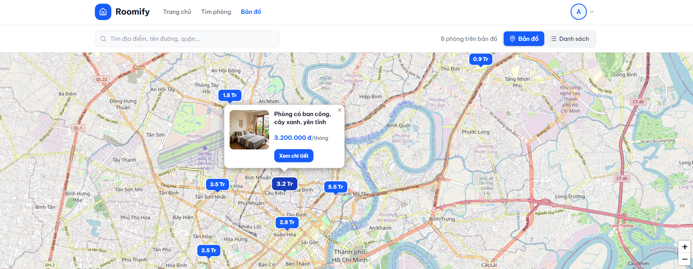

### UC-08: View Listing Details  

*Performed by: Từ Thái Hưng | Reviewed by: Võ Minh Khang | Edited by: Từ Thái Hưng*  

**1. Actor(s)**  
* Guest  

**2. Description**  
This use case allows a Guest to view the complete details of a specific boarding house listing, including an image gallery, detailed description, amenities, and automatically retrieved nearby places (e.g., schools, stores).  

**3. Preconditions**  
* The Guest is browsing the Search Listings page or the Map view.  

**4. Basic Flow (Main Success Scenario)**  
1. The Guest clicks on a listing card (from UC-06) or a map info pop-up (from UC-07).  
2. The system retrieves the full details of the selected listing from the database, including pre-calculated nearby geographic information.  
3. The system displays the Listing Details page, showing the image gallery, title, price, address, description, amenities, and nearby places.  
4. The Guest scrolls through the page to review the provided information.  

**5. Alternative Flows**  
* **5.1 Listing Unavailable:** At step 2, if the listing has been deleted, hidden, or is no longer approved, the system displays an error message ("Phòng trọ không tồn tại hoặc đã bị gỡ") and provides a button to return to the Search page.  
* **5.2 View Contact Information:** At step 4, the Guest clicks the "Xem thông tin liên hệ" (View Contact) button. The system triggers **UC-09 View Landlord Contact Information**.  

**6. Postconditions**  
* The Guest is successfully presented with all public details of the selected listing.  

**7. Special Requirements**  
* **Data Retrieval:** Nearby places (schools, convenience stores) should load quickly from the database, as they are populated during the Admin approval phase (UC-21).  

**8. UI Prototype**  

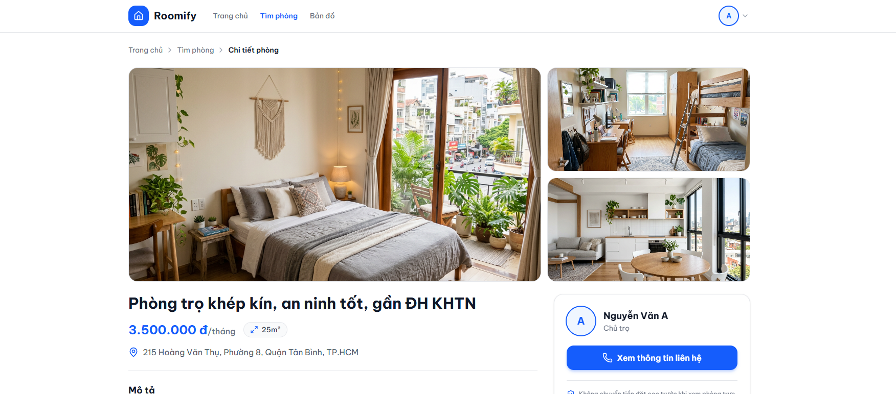
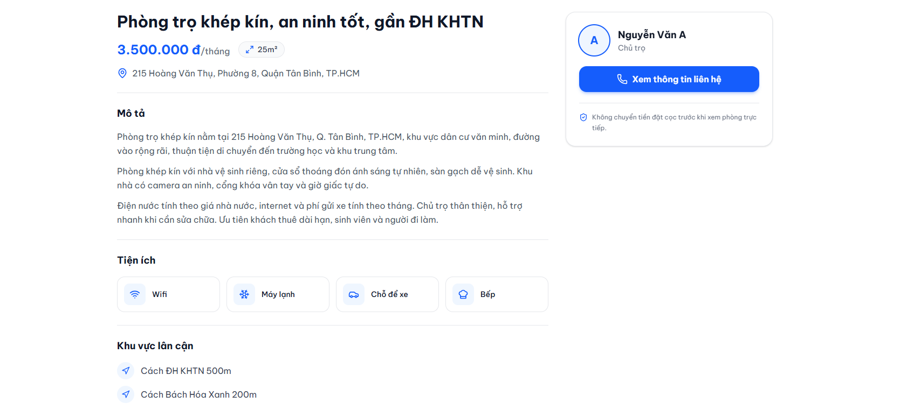

### UC-09: View Landlord Contact Information  

*Performed by: Từ Thái Hưng | Reviewed by: Võ Minh Khang | Edited by: Từ Thái Hưng*  

**1. Actor(s)**  
* Registered User  

**2. Description**  
This use case allows an authenticated user to reveal and view the hidden contact details (such as phone number and Zalo link) of the landlord associated with a specific listing.  

**3. Preconditions**  
* The user is viewing a specific Listing Details page (UC-08).  

**4. Basic Flow (Main Success Scenario)**  
1. The user clicks the "Xem thông tin liên hệ" (View Contact Information) button on the landlord profile card.  
2. The system verifies that the user is currently logged in (authenticated).  
3. The system retrieves the landlord's private contact details from the database.  
4. The system dynamically updates the UI to reveal the contact information (e.g., Phone number, Zalo, Email) in place of the button, or displays it in a modal popup.  

**5. Alternative Flows**  
* **5.1 User Not Logged In (Guest):** At step 2, if the system detects the user is a Guest, it displays a prompt stating "Vui lòng đăng nhập để xem thông tin liên hệ". The system provides links to Log In (UC-02) or Register (UC-01). Once the user successfully logs in, they are redirected back to the Listing Details page.  
* **5.2 Contact Info Unavailable:** At step 3, if the landlord has not provided a specific contact method (e.g., no Zalo link), the system only displays the available methods (e.g., just the phone number).  

**6. Postconditions**  
* The user successfully views the landlord's contact information and can initiate communication outside or inside the platform.  

**7. Special Requirements**  
* **Privacy & Security:** Contact information must never be included in the initial API payload for Guests. It must only be fetched securely via an authenticated API request.  

**8. UI Prototype**  

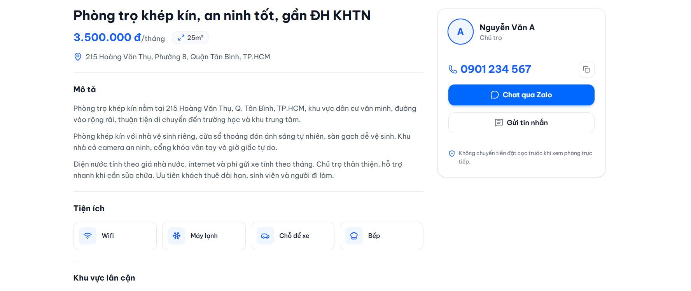

### UC-10: Manage Favorite Listings  

*Performed by: Từ Thái Hưng | Reviewed by: Võ Minh Khang | Edited by: Từ Thái Hưng*  

**1. Actor(s)**  
* Tenant  

**2. Description**  
This use case allows a logged-in Tenant to save specific boarding house listings to a personal "Favorites" list for later review and comparison. Tenants can also remove listings from this list.  

**3. Preconditions**  
* The user is authenticated and logged into the Roomify system with the "Tenant" role.  

**4. Basic Flow (Main Success Scenario)**  
1. The Tenant browses listings on the Search page (UC-06) or views a specific Listing Details page (UC-08).  
2. The Tenant clicks the "Trái tim" (Heart / Save) icon on a listing.  
3. The system saves the listing ID to the Tenant's favorites list in the database.  
4. The system updates the UI, changing the Heart icon to a filled/active state (e.g., solid red or blue) and displays a quick success toast notification.  
5. The Tenant navigates to the "Phòng đã lưu" (Saved/Favorite Listings) page via the user dropdown menu.  
6. The system retrieves and displays a grid of all listings the Tenant has saved.  

**5. Alternative Flows**  
* **5.1 Remove from Favorites:** At step 2, if the Tenant clicks an already filled Heart icon, the system removes the listing from their favorites list and changes the icon back to an empty state. If done from the "Saved Listings" page, the listing card disappears from the grid after a refresh.  
* **5.2 Empty Favorites List:** At step 6, if the Tenant has not saved any listings, the system displays a friendly empty state message (e.g., "Bạn chưa lưu phòng trọ nào") with a button to "Khám phá phòng trọ".  

**6. Postconditions**  
* The Tenant's favorites list is successfully updated and persistent across sessions.  

**7. Special Requirements**  
* If a saved listing is subsequently deleted by the Landlord or rejected by the Admin, it should be marked as "Không còn khả dụng" (Unavailable) or automatically removed from the Tenant's favorites list.  

**8. UI Prototype**  

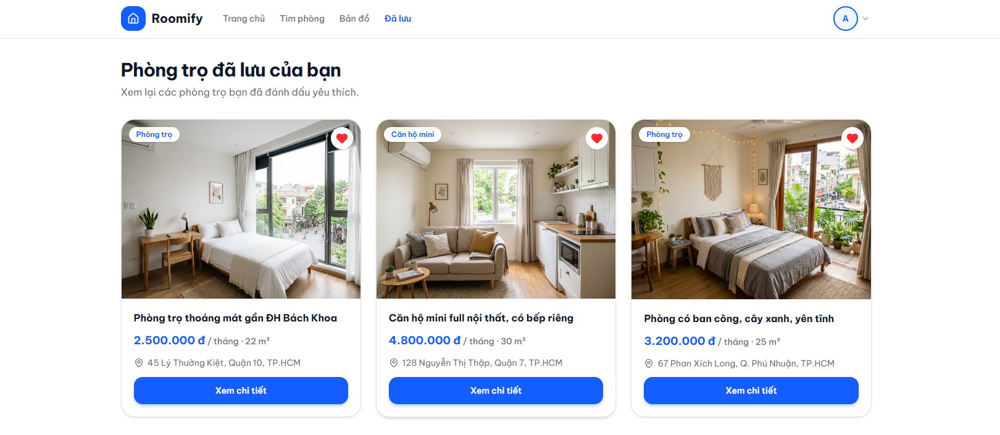

### UC-11: Chat with AI Assistant  

*Performed by: Từ Thái Hưng | Reviewed by: Võ Minh Khang | Edited by: Từ Thái Hưng*  

**1. Actor(s)**  
* Guest (Primary)  
* LLM Service (Secondary)  

**2. Description**  
This use case allows a Guest to interact with an AI-powered chatbot to ask questions regarding boarding house rentals, get platform navigation help, and receive instant, natural-language support.  

**3. Preconditions**  
* The Guest has opened the Roomify web application.  
* The LLM Service (e.g., Gemini or Claude API) is operational.  

**4. Basic Flow (Main Success Scenario)**  
1. The Guest clicks the AI floating chat widget icon located at the bottom right of the screen.  
2. The system expands the widget into a chat window and displays a welcome message.  
3. The Guest types a question (e.g., "Làm sao để tìm phòng giá rẻ ở Thủ Đức?") into the input field and clicks the Send button.  
4. The system displays the Guest's message in the chat window.  
5. The system sends the user's prompt securely to the external LLM Service.  
6. The LLM Service processes the prompt and returns a generated text response.  
7. The system displays the AI's response in the chat window.  

**5. Alternative Flows**  
* **5.1 LLM Service Timeout/Error:** At step 6, if the LLM Service fails to respond within a specific timeframe or returns an error, the system displays a fallback message in the chat window (e.g., "Xin lỗi, trợ lý AI hiện đang bận. Vui lòng thử lại sau.") and logs the error. The use case ends.  
* **5.2 Empty Input:** At step 3, if the Guest attempts to send an empty message, the system disables the send button or ignores the action. The use case resumes at step 3.  

**6. Postconditions**  
* The Guest receives a helpful, context-aware answer from the AI assistant.  
* The chat history is maintained for the duration of the current session.  

**7. Special Requirements**  
* **Latency:** The system should display a "typing..." indicator while waiting for the LLM Service's response to improve UX.  

**8. UI Prototype**  

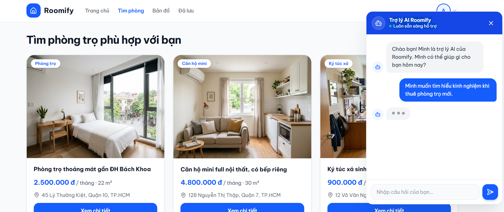