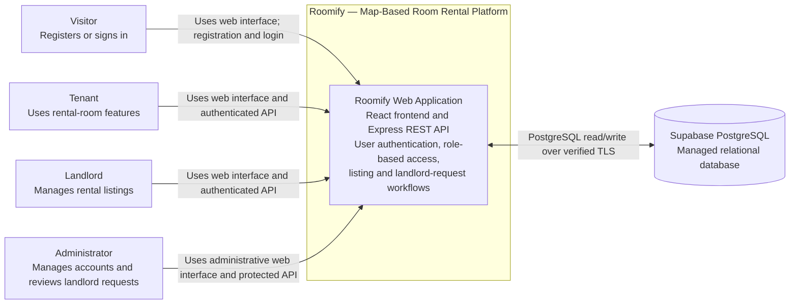

# Roomify Software Architecture

**Performed by:** Nguyễn Hữu Nghĩa | **Reviewed by:** Đỗ Quốc Đại | **Edited by:** Nguyễn Hữu Nghĩa  

**Project:** Roomify — Map-Based Room Rental Platform  
**Course:** CS300 / CSC13002 — Introduction to Software Engineering  
**Group:** 13  
**Assignment:** PA4-2026  
**Document status:** Draft based on the repository implementation inspected on 2026-11-11. Update this document as PA4 features and deployment decisions are confirmed.

## 1. Technology Stack

**Performed by:** Nguyễn Hữu Nghĩa | **Reviewed by:** Đỗ Quốc Đại | **Edited by:** Nguyễn Hữu Nghĩa  

The following technologies are evidenced by the current source code and dependency manifests.

| Area | Technology | Responsibility and evidence |
|---|---|---|
| Web frontend | React 18, JavaScript, Vite 5 | Renders the Roomify user interface. Vite serves the development application on port `5173` and proxies `/api/v1` requests to the backend during local development. |
| Client-side routing | React Router 6 | Provides navigation between the frontend pages and protected role-based routes. |
| Backend API | Node.js, Express 4, JavaScript | Provides the JSON REST API under `/api/v1`, including authentication, administrator, listing, and landlord-request routes. |
| Input validation | Zod | Validates backend request data where defined by the services. |
| Database access | PostgreSQL with `pg` | The backend uses a PostgreSQL connection pool and parameterized queries. Database migrations are managed with `node-pg-migrate`. |
| Managed database service | Supabase PostgreSQL | The backend configuration validates Supabase Direct or Session Pooler connection URLs and uses verified TLS. Runtime and test projects are configured separately. |
| Authentication | JSON Web Tokens (`jsonwebtoken`) and `bcryptjs` | The API issues and validates JWTs; passwords are hashed and verified with bcrypt. Authentication is implemented in the Roomify backend rather than delegated to an external identity provider. |
| Backend verification | Jest and Supertest | Runs backend unit and API integration tests. |
| Frontend end-to-end verification | Playwright | Runs the configured browser-based end-to-end tests. |

### 1.1 Communication and Configuration

**Performed by:** Nguyễn Hữu Nghĩa | **Reviewed by:** Đỗ Quốc Đại | **Edited by:** Nguyễn Hữu Nghĩa  

- The browser frontend sends JSON HTTP requests to the backend under `/api/v1`. Authentication requests use bearer tokens where required.
- During local development, Vite proxies `/api/v1` to the backend at `http://127.0.0.1:3000`. This is a development configuration, not a production hosting decision.
- The backend connects to Supabase PostgreSQL over TLS on port `5432`, using either the Direct endpoint or Session Pooler. Production hosting for the web frontend and API has not been confirmed in the inspected repository.
- Database and token secrets are supplied through environment configuration. Environment files containing real credentials must not be committed or included in the submission package.

## 2. C4 Level 1 — System Context

**Performed by:** Nguyễn Hữu Nghĩa | **Reviewed by:** Đỗ Quốc Đại | **Edited by:** Nguyễn Hữu Nghĩa  

### 2.1 Diagram

### 2.2 System and Actor Descriptions

**Performed by:** Nguyễn Hữu Nghĩa | **Reviewed by:** Đỗ Quốc Đại | **Edited by:** Nguyễn Hữu Nghĩa  

| Element | Description |
|---|---|
| Roomify | The software system presented to users through a React web application and an Express REST API. The current source includes account registration and login, JWT-protected access, role-aware administration, listing-related routes, and landlord access-request workflows. |
| Visitor | A person who is not signed in. Visitors use the web interface to register or log in. |
| Tenant | A signed-in user with the tenant role. Tenants use Roomify's tenant-facing functionality and can submit a request to become a landlord. |
| Landlord | A signed-in user with the landlord role. Landlords use Roomify's landlord-facing listing functionality. Access to protected listing operations is checked by the backend. |
| Administrator | A signed-in user with the administrator role. Administrators can use protected account-management and landlord-request review operations. |
| Supabase PostgreSQL | An externally managed database service. The Roomify backend reads and writes persistent application data through PostgreSQL connections protected by verified TLS. |

### 2.3 Diagram Notes and Scope

**Performed by:** Nguyễn Hữu Nghĩa | **Reviewed by:** Đỗ Quốc Đại | **Edited by:** Nguyễn Hữu Nghĩa  

- The Roomify boundary represents the software product as users experience it; the React frontend and Express API are intentionally shown as one system at C4 Level 1. They will be separated into containers in the Level 2 diagram.
- Supabase PostgreSQL is shown outside the Roomify software boundary because it is a separately managed service. The Level 2 diagram should show the database container and its managed hosting relationship consistently with this view.
- The roles and interactions above are based on the current frontend routes, backend API routes, and authorization middleware. A diagram does not imply that every planned product feature is already complete.
- No source-code evidence was found for an integrated external map provider, AI provider, OAuth/identity provider, email provider, or object-storage service. They are therefore not shown as current dependencies. Add them only after the team selects and implements them, and update the diagrams to match.
- Production hosting for the frontend and backend is not specified by the inspected configuration. Document the actual deployment nodes and protocols in the PA4 deployment section after the team confirms its hosting setup.
