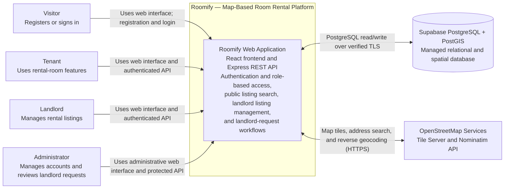
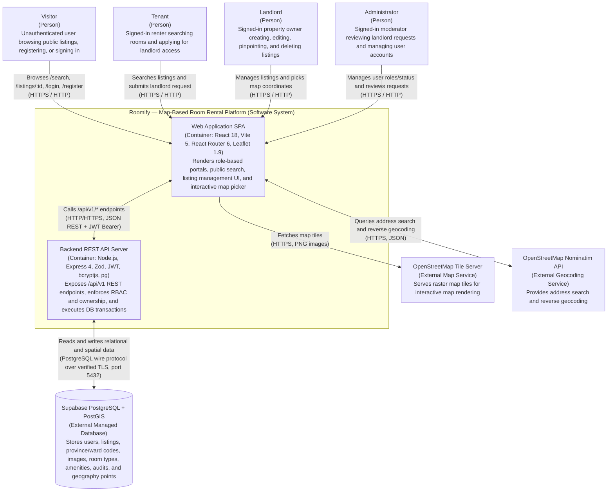
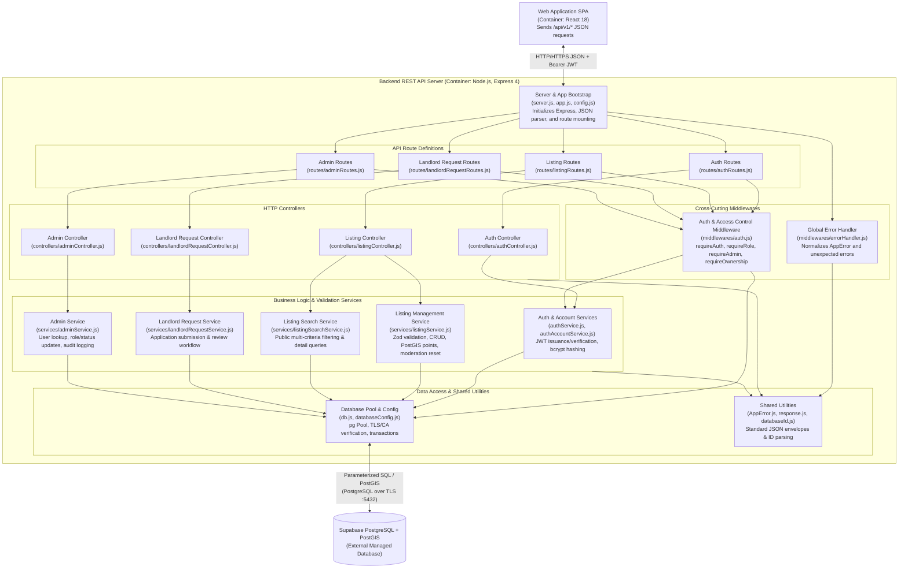
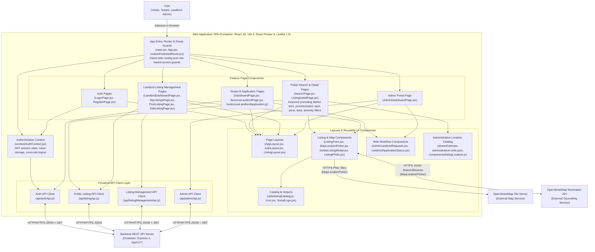
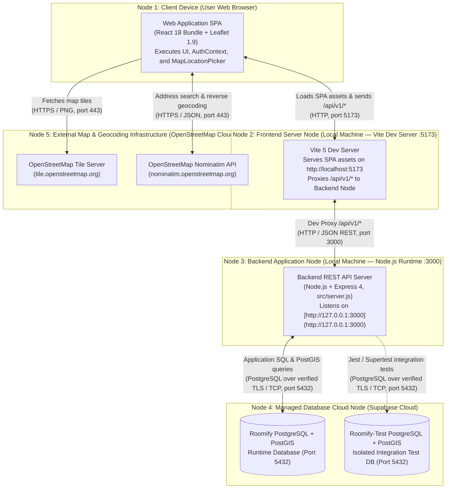

# Roomify Software Architecture

**Performed by:** Nguyễn Hữu Nghĩa | **Reviewed by:** Đỗ Quốc Đại | **Edited by:** Nguyễn Hữu Nghĩa  

**Project:** Roomify — Map-Based Room Rental Platform  
**Course:** CS300 / CSC13002 — Introduction to Software Engineering  
**Group:** 13  
**Assignment:** PA4-2026  
**Document status:** Updated on 2026-11-25 to describe the implemented PA4 functional groups and the repository's local-development deployment topology. Production hosting for the frontend and backend is not specified in the repository.

## 1. Technology Stack

**Performed by:** Nguyễn Hữu Nghĩa | **Reviewed by:** Đỗ Quốc Đại | **Edited by:** Nguyễn Hữu Nghĩa  

The following technologies are evidenced by the current source code and dependency manifests.

| Area | Technology | Responsibility and evidence |
|---|---|---|
| Web frontend | React 18, JavaScript, Vite 5 | Renders the Roomify user interface. Vite serves the development application on port `5173` and proxies `/api/v1` requests to the backend during local development. |
| Client-side routing | React Router 6 | Provides navigation between the frontend pages and protected role-based routes. |
| Interactive map & geocoding | Leaflet 1.9, OpenStreetMap Tile Server, Nominatim API | Renders interactive map selection, draggable coordinate pins, address search, and reverse geocoding in `MapLocationPicker.jsx`. |
| Shared administrative-location catalog | `shared/vietnam-administrative-units.json` | Provides the province and ward codes and labels used by the search UI and listing-location display; the backend uses it to validate search filters. |
| Backend API | Node.js, Express 4, JavaScript | Provides the JSON REST API under `/api/v1`, including authentication, administrator, listing, and landlord-request routes. |
| Input validation | Zod | Validates backend request data where defined by the services. |
| Database access | PostgreSQL with `pg` | The backend uses a PostgreSQL connection pool and parameterized queries. Database migrations are managed with `node-pg-migrate`. |
| Managed database service | Supabase PostgreSQL + PostGIS | The backend configuration validates Supabase Direct or Session Pooler connection URLs, uses verified TLS, and stores spatial coordinates (`geography(Point, 4326)`) via PostGIS. Runtime and test projects are configured separately. |
| Authentication | JSON Web Tokens (`jsonwebtoken`) and `bcryptjs` | The API issues and validates JWTs; passwords are hashed and verified with bcrypt. Authentication is implemented in the Roomify backend rather than delegated to an external identity provider. |
| Backend verification | Jest and Supertest | Runs backend unit and API integration tests. |
| Frontend end-to-end verification | Playwright | Runs the configured browser-based end-to-end tests. |

### 1.1 Communication and Configuration

**Performed by:** Nguyễn Hữu Nghĩa | **Reviewed by:** Đỗ Quốc Đại | **Edited by:** Nguyễn Hữu Nghĩa  

- The browser frontend sends JSON HTTP requests to the backend under `/api/v1`. Authentication requests use bearer tokens where required.
- For interactive map selection, the browser frontend communicates directly over HTTPS with OpenStreetMap Tile Server (`tile.openstreetmap.org`) and OpenStreetMap Nominatim API (`nominatim.openstreetmap.org`).
- During local development, Vite proxies `/api/v1` to the backend at `http://127.0.0.1:3000`. This is a development configuration, not a production hosting decision.
- The backend connects to Supabase PostgreSQL over TLS on port `5432`, using either the Direct endpoint or Session Pooler. Production hosting for the web frontend and API has not been confirmed in the inspected repository.
- Database and token secrets are supplied through environment configuration. Environment files containing real credentials must not be committed or included in the submission package.

## 2. C4 Level 1 — System Context

**Performed by:** Nguyễn Hữu Nghĩa | **Reviewed by:** Đỗ Quốc Đại | **Edited by:** Nguyễn Hữu Nghĩa  

### 2.1 Diagram

### 2.2 System and Actor Descriptions

**Performed by:** Nguyễn Hữu Nghĩa | **Reviewed by:** Đỗ Quốc Đại | **Edited by:** Nguyễn Hữu Nghĩa  

| Element | Description |
|---|---|
| Roomify | The software system presented to users through a React web application and an Express REST API. The current source includes public search and approved-listing details, landlord listing management, account registration and login, JWT-protected access, role-aware administration, and landlord access-request workflows. |
| Visitor | A person who is not signed in. Visitors can search approved listings and view their details, and can register or log in. |
| Tenant | A signed-in user with the tenant role. Tenants use Roomify's tenant-facing functionality and can submit a request to become a landlord. |
| Landlord | A signed-in user with the landlord role. Landlords use Roomify's landlord-facing listing functionality. Access to protected listing operations is checked by the backend. |
| Administrator | A signed-in user with the administrator role. Administrators can use protected account-management and landlord-request review operations. |
| Supabase PostgreSQL + PostGIS | An externally managed database service. The Roomify backend reads and writes persistent application and PostGIS spatial data through PostgreSQL connections protected by verified TLS. |
| OpenStreetMap Services | External map and geocoding services (`Tile Server` and `Nominatim API`) queried over HTTPS by the frontend map picker for map tiles, address search, and reverse geocoding. |

### 2.3 Diagram Notes and Scope

**Performed by:** Nguyễn Hữu Nghĩa | **Reviewed by:** Đỗ Quốc Đại | **Edited by:** Nguyễn Hữu Nghĩa  

- The Roomify boundary represents the software product as users experience it; the React frontend and Express API are intentionally shown as one system at C4 Level 1. They will be separated into containers in the Level 2 diagram.
- Supabase PostgreSQL + PostGIS is shown outside the Roomify software boundary because it is a separately managed service. The Level 2 diagram should show the database container and its managed hosting relationship consistently with this view.
- The roles and interactions above are based on the current frontend routes, backend API routes, and authorization middleware. A diagram does not imply that every planned product feature is already complete.
- OpenStreetMap Tile Server and Nominatim API are shown as external map and geocoding dependencies used by the frontend. No source-code evidence was found for an integrated AI provider, OAuth/identity provider, email provider, or object-storage service; they are therefore not shown as current dependencies. Add them only after the team selects and implements them, and update the diagrams to match.
- Section 5 documents the local-development deployment topology and its communication protocols. The repository does not specify production hosting for the frontend or backend; do not present the local Vite setup as a production deployment.

## 3. C4 Level 2 — Container Diagram

**Performed by:** Đỗ Quốc Đại | **Reviewed by:** Từ Thái Hưng | **Edited by:** Đỗ Quốc Đại

### 3.1 Container Diagram

**Performed by:** Đỗ Quốc Đại | **Reviewed by:** Từ Thái Hưng | **Edited by:** Đỗ Quốc Đại

### 3.2 Container Descriptions

**Performed by:** Đỗ Quốc Đại | **Reviewed by:** Từ Thái Hưng | **Edited by:** Đỗ Quốc Đại

#### 3.2.1 Web Application (SPA)

**Performed by:** Đỗ Quốc Đại | **Reviewed by:** Từ Thái Hưng | **Edited by:** Đỗ Quốc Đại

- **Responsibility and Services Provided:**
  - Delivers the client-side Single Page Application running inside the user's browser across all implemented functional areas:
    - **Authentication and Role-Aware Session Management:** Registration (`/register`), login (`/login`), logout, JWT token persistence (`sessionStorage` / `localStorage`), cross-tab logout synchronization, and protected route guards (`ProtectedRoute`, `RoleRoute`) via `AuthContext`.
    - **Tenant and Landlord Access Requests:** Personal dashboard (`/dashboard`) and landlord application workflow (`/become-landlord`).
    - **Administrator Portal:** User lookup, role/status updates, and landlord request review queue (`/admin`).
    - **Public Listing Search and Details (FG1):** Keyword search across title/address/district and UI filters for province/city, ward/commune/special zone, room type, price, area, and amenities (`/search`), plus approved listing detail view (`/listings/:id`).
    - **Comprehensive Listing Management (FG2 — UC-13 to UC-17):** Landlord listing portfolio dashboard with moderation status tabs and summary counters (`/landlord/listings`), listing creation form (`/landlord/listings/create`), listing editor with automatic re-moderation notice (`/landlord/listings/:id/edit`), permanent deletion confirmation dialog (`DeleteListingModal`), and interactive map pinpointing (`MapLocationPicker`).
- **Technology / Framework Used:**
  - `react` (`^18.3.1`), `react-dom` (`^18.3.1`), `react-router-dom` (`^6.28.0`), `leaflet` (`^1.9.4`), and custom CSS (`styles.css`), bundled and served in development by `vite` (`^5.4.10`).
- **Communication with Other Containers & External Systems:**
  - **To Backend REST API Server:** Sends `fetch` HTTP/HTTPS requests carrying `application/json` payloads to `/api/v1/*` and includes `Authorization: Bearer <token>` headers for protected routes. Expects the standardized Roomify JSON response envelope (`{ success, data }` or `{ success, error }`).
  - **To OpenStreetMap Tile Server:** Directly requests raster tile images (`https://{s}.tile.openstreetmap.org/{z}/{x}/{y}.png`) via HTTPS from the browser when `MapLocationPicker` is opened.
  - **To OpenStreetMap Nominatim API:** Directly sends HTTPS `GET` requests to `/search` (forward address lookup) and `/reverse` (coordinate-to-address reverse geocoding) with JSON responses.

#### 3.2.2 Backend REST API Server

**Performed by:** Đỗ Quốc Đại | **Reviewed by:** Từ Thái Hưng | **Edited by:** Đỗ Quốc Đại

- **Responsibility and Services Provided:**
  - Acts as the central application server enforcing business logic, input validation, authentication, authorization, and transactional database persistence under `/api/v1`:
    - **Health & Authentication (`/api/v1/health`, `/api/v1/auth`):** Exposes `GET /api/v1/health` along with `/register`, `/login`, `/me`, and `/logout` under `/api/v1/auth`; hashes passwords using `bcryptjs` and issues/verifies HS256 JWT tokens.
    - **Access Control Middlewares:** Verifies live database account state (`requireAuth`), role permissions (`requireRole`, `requireAdmin`), and resource ownership (`requireOwnership`).
    - **Administration & Landlord Requests (`/api/v1/admin`, `/api/v1/landlord-requests`):** Handles user lookup, role/active-status updates with audit logging, and landlord request submission/review.
    - **Public Search & Listing Management (`/api/v1/listings`):** Exposes `GET /filters`, `GET /`, `POST /`, `GET /mine`, `GET /mine/:id`, `GET /:id`, `PATCH /:id`, and `DELETE /:id`. Search validates district, province and ward codes, room type, price, area, and amenity filters. Listing writes use strict `camelCase` Zod validation, ownership checks, pessimistic row-level locking (`SELECT ... FOR UPDATE`), PostGIS spatial point construction (`ST_SetSRID(ST_MakePoint(lng, lat), 4326)::geography`), transactional image/amenity updates, and moderation reset to `pending` upon substantive edits.
- **Technology / Framework Used:**
  - Node.js (CommonJS), `express` (`^4.21.2`), `zod` (`^3.24.1`), `jsonwebtoken` (`^9.0.3`), `bcryptjs` (`^3.0.3`), and `pg` (`^8.13.1`), with `dotenv` (`^16.4.7`) for environment loading.
- **Communication with Other Containers & External Systems:**
  - **With Web Application (SPA):** Receives JSON REST requests over HTTP/HTTPS on port `3000` (configurable via `PORT`) and returns standardized JSON responses and HTTP status codes (`200`, `201`, `400`, `401`, `403`, `404`, `500`).
  - **With Supabase PostgreSQL + PostGIS:** Maintains a `pg` connection pool (`search_path=public,extensions`) connecting to Supabase Direct or Session Pooler endpoints on port `5432` over verified TLS (with optional custom CA certificate verification).

#### 3.2.3 External Managed and Third-Party Systems

**Performed by:** Đỗ Quốc Đại | **Reviewed by:** Từ Thái Hưng | **Edited by:** Đỗ Quốc Đại

| External System | Role in Container Architecture | Communication & Integration Notes |
|---|---|---|
| **Supabase PostgreSQL + PostGIS** | External managed relational and geospatial database storing `users`, `listings` (including nullable `province_code` and `ward_code`), `listing_images`, `room_types`, `amenities`, `listing_amenities`, `nearby_places`, `favorites`, `landlord_requests`, and `admin_action_audits`. | Accessed exclusively by the Backend REST API Server over PostgreSQL wire protocol with verified TLS on port `5432`. Direct client-side Supabase Data API access is revoked (`1700000003000_supabase_backend_only.js`). |
| **OpenStreetMap Tile Server** | External public map tile CDN providing base map imagery inside `MapLocationPicker`. | Accessed directly by the Web Application SPA over HTTPS (`GET` PNG tiles); no API key is required or stored in the backend. |
| **OpenStreetMap Nominatim API** | External geocoding service used to search Vietnamese street/district queries and reverse-geocode dragged map pin coordinates. | Accessed directly by the Web Application SPA over HTTPS (`GET` JSON); includes client-side timeout and manual-input fallback so network latency never blocks listing submission. |

### 3.3 Consistency Notes with Level 1 & Source Code

**Performed by:** Đỗ Quốc Đại | **Reviewed by:** Từ Thái Hưng | **Edited by:** Đỗ Quốc Đại

1. **Refinement from Level 1:** The single `Roomify Web Application` system box in Section 2 (C4 Level 1) is decomposed here into two runtime containers: the browser-hosted **Web Application (SPA)** and the Node.js **Backend REST API Server**.
2. **Local Development Proxy vs. Logical Architecture:** In `frontend/vite.config.js`, Vite serves the SPA on `http://localhost:5173` and proxies `/api/v1` calls to `http://127.0.0.1:3000` to avoid CORS issues during local development. Logically, all business API traffic flows directly from the Web Application container to the Backend REST API container.
3. **PA4 feature synchronization:** Public search accepts `provinceCode` and `wardCode` in addition to the district, room-type, price, area, and amenity filters. The backend validates these codes against `shared/vietnam-administrative-units.json`. The database has nullable `province_code` and `ward_code` columns, but the current listing create/update API does not write them; listings remain unclassified for province/ward filtering unless those values are populated separately. This limitation should be resolved or explicitly accepted before claiming that newly created listings are searchable by province and ward.

## 4. C4 Level 3 — Component Diagrams

**Performed by:** Từ Thái Hưng | **Reviewed by:** Nguyễn Hữu Nghĩa | **Edited by:** Từ Thái Hưng

This section decomposes the two Roomify runtime containers defined in Section 3 (**Web Application SPA** and **Backend REST API Server**) into their internal software components based on the current repository implementation.

---

### 4.1 Backend REST API Server — Component Diagram

**Performed by:** Từ Thái Hưng | **Reviewed by:** Nguyễn Hữu Nghĩa | **Edited by:** Từ Thái Hưng

#### 4.1.1 Backend Component Descriptions

**Performed by:** Từ Thái Hưng | **Reviewed by:** Nguyễn Hữu Nghĩa | **Edited by:** Từ Thái Hưng

| Component | Source Files | Responsibility | Relationships |
|---|---|---|---|
| **Server & App Bootstrap** | `server.js`, `app.js`, `config.js` | Loads environment configuration, creates the Express application, registers JSON body parsing, exposes `/api/v1/health`, and mounts all feature routers and the global error handler. | Receives HTTP requests from the **Web Application SPA**; delegates routing to **API Route Definitions** and forwards unhandled errors to **Global Error Handler**. |
| **Auth & Access Control Middleware** | `middlewares/auth.js` | Verifies JWT bearer tokens (`requireAuth`), checks live account active status in the database, enforces role-based access (`requireRole`, `requireAdmin`), and verifies listing ownership (`requireOwnership`). | Invoked by protected routes before controllers; uses **Auth Service** for token verification and **Database Pool** for live user/ownership checks. |
| **Global Error Handler** | `middlewares/errorHandler.js` | Catches synchronous and asynchronous errors across the request lifecycle and formats consistent HTTP error responses (`400`, `401`, `403`, `404`, `500`). | Registered at the end of the Express pipeline in `app.js`; uses `AppError` and `response.js` from **Shared Utilities**. |
| **API Route Definitions** | `authRoutes.js`, `listingRoutes.js`, `landlordRequestRoutes.js`, `adminRoutes.js` | Maps REST endpoints under `/api/v1/*` to their respective middleware chains and controller handlers (e.g., registering `/listings/mine` above `/listings/:id`). | Mounted by **Server & App Bootstrap**; chains **Auth & Access Control Middleware** into **HTTP Controllers**. |
| **HTTP Controllers** | `authController.js`, `listingController.js`, `landlordRequestController.js`, `adminController.js` | Extracts request parameters, query strings, authenticated user context (`req.user`), and JSON payloads; delegates business operations to services and returns standardized JSON envelopes. | Called by **API Route Definitions**; invokes **Business Logic Services** and formats responses via **Shared Utilities**. |
| **Auth & Account Services** | `authService.js`, `authAccountService.js` | Handles user registration, login credential verification (`bcryptjs`), HS256 JWT issuance/verification (`jsonwebtoken`), and current-user profile retrieval. | Called by **Auth Controller** and **Auth Middleware**; reads/writes `users` via **Database Pool**. |
| **Listing Management Service** | `listingService.js` | Implements landlord listing CRUD (UC-13 to UC-17): strict `zod` payload validation, PostGIS `ST_SetSRID(ST_MakePoint(lng, lat), 4326)::geography` creation, transactional image/amenity syncing, `SELECT ... FOR UPDATE` row locking, no-op update detection, and automatic moderation reset (`status = 'pending'`, `reject_reason = NULL`). | Called by **Listing Controller**; executes multi-statement SQL transactions via **Database Pool**. |
| **Listing Search Service** | `listingSearchService.js`, `shared/vietnam-administrative-units.json` | Implements public room search and filtering (keyword, district, province, ward, room type, price, area, amenities), validates location codes against the shared administrative-unit catalog, provides filter metadata, and retrieves approved listing details. | Called by **Listing Controller**; executes read-only parameterized queries via **Database Pool**. |
| **Landlord Request & Admin Services** | `landlordRequestService.js`, `adminService.js` | Manages tenant-to-landlord upgrade applications, administrator approval/rejection workflows, user role/status updates, and `admin_action_audits` logging. | Called by **Landlord Request Controller** and **Admin Controller**; persists state via **Database Pool**. |
| **Database Pool & Shared Utilities** | `db.js`, `databaseConfig.js`, `AppError.js`, `response.js`, `databaseId.js` | Manages the `pg` connection pool (`search_path=public,extensions`), validates Supabase Direct/Session Pooler URLs and TLS certificates, and provides shared error/response/UUID helpers. | Used by all **Services**, **Controllers**, and **Middlewares**; communicates directly with **Supabase PostgreSQL + PostGIS**. |

---

### 4.2 Web Application (SPA) — Component Diagram

**Performed by:** Từ Thái Hưng | **Reviewed by:** Nguyễn Hữu Nghĩa | **Edited by:** Từ Thái Hưng

#### 4.2.1 Frontend Component Descriptions

**Performed by:** Từ Thái Hưng | **Reviewed by:** Nguyễn Hữu Nghĩa | **Edited by:** Từ Thái Hưng

| Component | Source Files | Responsibility | Relationships |
|---|---|---|---|
| **App Entry, Router & Route Guards** | `main.jsx`, `App.jsx`, `routes/ProtectedRoute.jsx` | Bootstraps the React application, declares client-side routes, and enforces authentication and role checks before rendering protected pages. | Wraps the app in **Authentication Context**; routes users to **Feature Page Components**. |
| **Authentication Context** | `context/AuthContext.jsx` | Maintains global user session state, persists JWT tokens (`localStorage` / `sessionStorage`), restores active sessions via `/api/v1/auth/me`, and synchronizes logout across browser tabs. | Consumed by **Route Guards** and **Feature Page Components**; communicates with **Auth API Client**. |
| **Auth Pages** | `LoginPage.jsx`, `RegisterPage.jsx` | Renders sign-in and registration forms with client-side validation and error feedback. | Uses `AuthLayout.jsx` and delegates session actions to **Authentication Context**. |
| **Public Search & Detail Pages** | `SearchPage.jsx`, `ListingDetailPage.jsx` | Provides multi-criteria room search/filtering (FG1), including province and ward filters, and displays approved listing details, photos, amenities, and location. | Uses `ListingLayout.jsx` and `ListingPhoto.jsx`; fetches data via **Public Listing API Client** and reads province/ward labels from the shared administrative-unit catalog. |
| **Tenant & Application Pages** | `DashboardPage.jsx`, `BecomeLandlordPage.jsx`, `hooks/useLandlordApplication.js` | Displays personal dashboard and lets tenants submit and track landlord upgrade requests. | Uses `AppLayout.jsx` and `LandlordApplicationStatus.jsx`; calls **Auth API Client**. |
| **Landlord Listing Management Pages** | `LandlordDashboardPage.jsx`, `MyListingsPage.jsx`, `PostListingPage.jsx`, `EditListingPage.jsx` | Implements FG2 (UC-13 to UC-17): landlord portfolio overview, status-tabbed listing table with rejection reasons, create/edit listing workflows, and delete triggers. | Composes `ListingForm.jsx`, `MapLocationPicker.jsx`, and `DeleteListingModal.jsx`; calls **Listing Management API Client** and **Public Listing API Client**. |
| **Admin Portal Page** | `AdminDashboardPage.jsx` | Allows administrators to search users, update roles/account status, and approve or reject landlord requests. | Composes `AdminLandlordRequests.jsx` and `AppLayout.jsx`; calls **Admin API Client**. |
| **Listing & Map UI Components** | `ListingForm.jsx`, `MapLocationPicker.jsx`, `DeleteListingModal.jsx`, `ListingPhoto.jsx` | Reusable domain components for listing form input/validation, interactive Leaflet map pinpointing with address search/reverse geocoding, deletion confirmation, and image rendering. | Embedded in **Landlord** and **Search Pages**; `MapLocationPicker.jsx` communicates directly with **OpenStreetMap Tile Server** and **Nominatim API**. |
| **Administrative Location Catalog** | `shared/vietnam-administrative-units.json`, `components/listingLocation.js` | Supplies province/ward options to public search and formats verified administrative codes for listing location display. Listing create/update forms currently capture address, district, and map coordinates, but do not save province/ward codes. | Used by **Public Search & Detail Pages**; the backend separately validates province/ward search codes against the same JSON catalog. |
| **Frontend API Client Layer** | `authApi.js`, `listingApi.js`, `listingManagementApi.js`, `adminApi.js` | Encapsulates `fetch` calls to `/api/v1/*`, attaches `Authorization: Bearer <token>` headers, and parses Roomify's standardized JSON response envelope. | Called by **Feature Page Components** and **Authentication Context**; sends HTTP/HTTPS requests to **Backend REST API Server**. |

---

## 5. Deployment Diagram

**Performed by:** Từ Thái Hưng | **Reviewed by:** Nguyễn Hữu Nghĩa | **Edited by:** Từ Thái Hưng

This diagram documents Roomify's **local-development topology**, not a production deployment: the Vite frontend server and Node.js backend run as separate processes on the developer/host machine, while persistent relational and geospatial data is hosted on **Supabase Cloud**, and map tiles/geocoding are consumed from **OpenStreetMap** public services. The repository does not identify production hosting for the frontend or backend.

### 5.1 Deployment Diagram

**Performed by:** Từ Thái Hưng | **Reviewed by:** Nguyễn Hữu Nghĩa | **Edited by:** Từ Thái Hưng

### 5.2 Infrastructure Node Descriptions

**Performed by:** Từ Thái Hưng | **Reviewed by:** Nguyễn Hữu Nghĩa | **Edited by:** Từ Thái Hưng

| Node | Hardware / Cloud Service | Containers / Components Running | Communication Protocols |
|---|---|---|---|
| **Node 1: Client Device (User Web Browser)** | End-user desktop or mobile device running a modern web browser (Chrome, Edge, Firefox). | **Web Application SPA** (React 18, React Router 6, Leaflet 1.9) executing in-browser. | **HTTP** (port `5173` in local dev) to the Frontend Server Node; **HTTPS** (port `443`) directly to OpenStreetMap Tile Server and Nominatim API. |
| **Node 2: Frontend Server Node** | Local host machine running Node.js with **Vite 5** (`frontend/vite.config.js`). | **Vite Development Server** bundling and serving the React SPA on `http://localhost:5173` and proxying `/api/v1/*` requests to avoid CORS issues. | **HTTP** (port `5173`) with the Client Browser; **HTTP** (JSON REST + JWT Bearer on port `3000`) to the Backend Application Node. |
| **Node 3: Backend Application Node** | Local host machine running **Node.js** runtime (`backend/src/server.js`). | **Backend REST API Server** (Express 4, Zod, JWT, bcryptjs, `pg` pool) listening on `http://127.0.0.1:3000` (configurable via `PORT`). | **HTTP** (port `3000`) receiving proxied `/api/v1/*` requests; **TCP with verified TLS** (PostgreSQL wire protocol, port `5432`) to Supabase Cloud via Direct (IPv6) or Session Pooler (IPv4) endpoints. |
| **Node 4: Managed Database Cloud Node** | **Supabase Cloud** managed PostgreSQL infrastructure. | Two isolated PostgreSQL + PostGIS databases: **Roomify** (runtime data) and **Roomify-Test** (automated Jest/Supertest integration testing). Direct client-side Data API access is disabled (`backend_only` migration). | **PostgreSQL wire protocol over verified TLS (TCP, port `5432`)**, exclusively accessible from the Backend Application Node (with optional CA certificate verification). |
| **Node 5: External Map & Geocoding Infrastructure** | **OpenStreetMap** public cloud infrastructure (`tile.openstreetmap.org` and `nominatim.openstreetmap.org`). | **OpenStreetMap Tile Server** (raster PNG map tiles) and **Nominatim API** (forward and reverse geocoding). | **HTTPS** (port `443`, `GET` PNG tiles and JSON responses) accessed directly from the Client Device's `MapLocationPicker` component. |