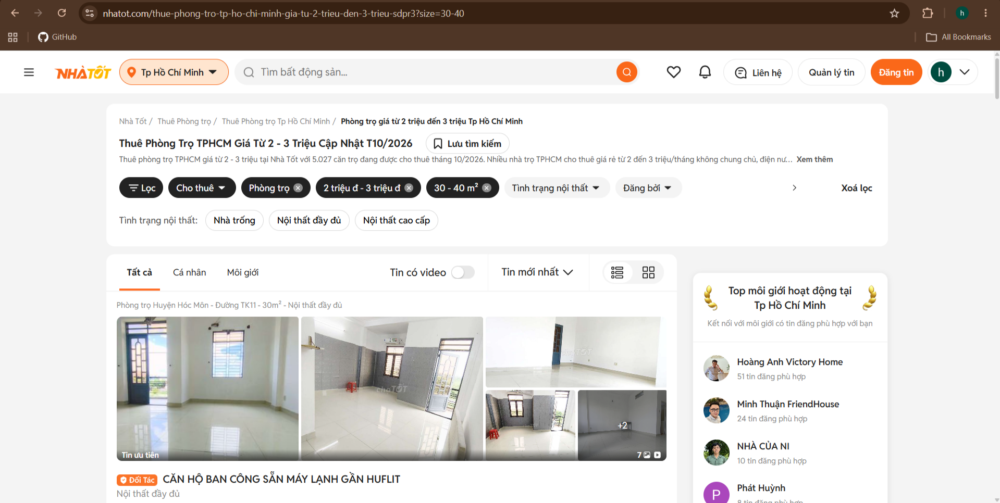
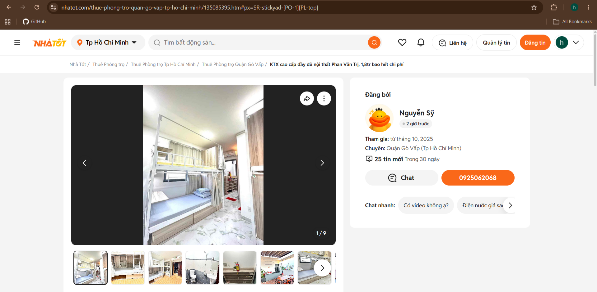
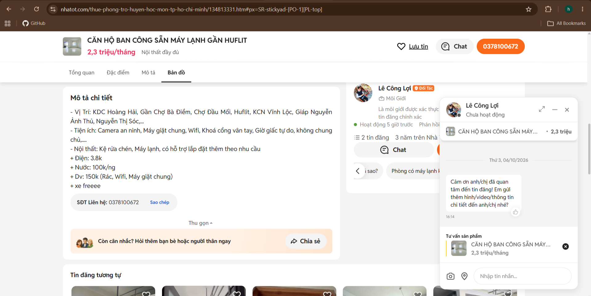
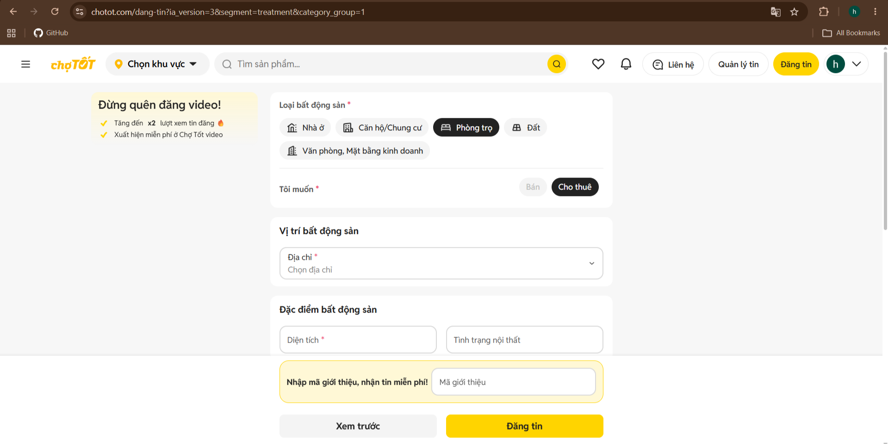
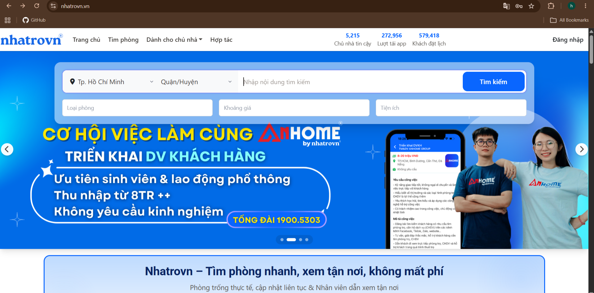
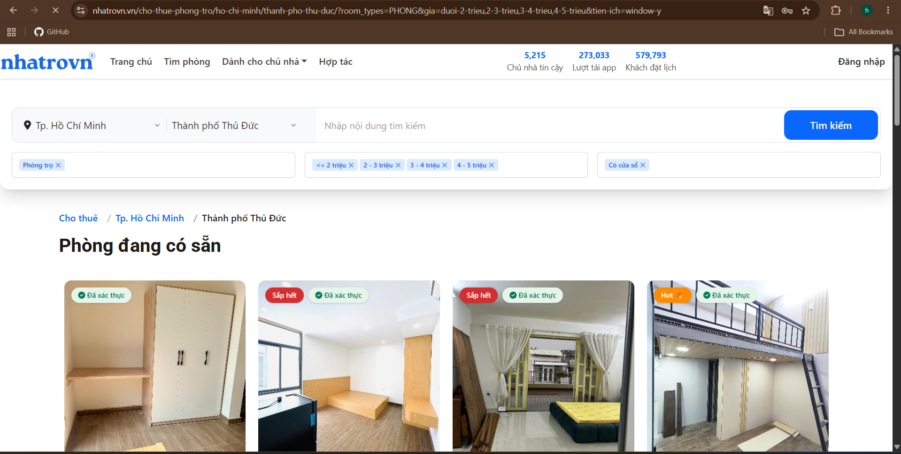
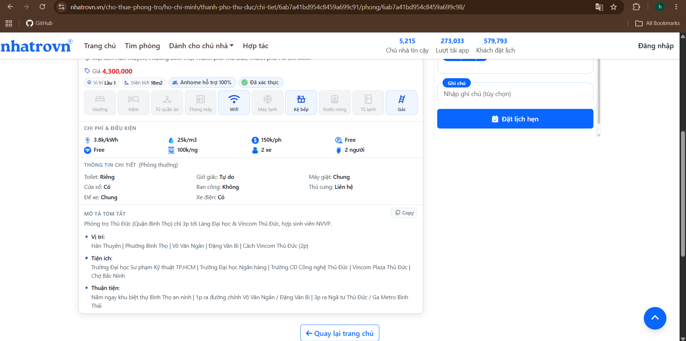
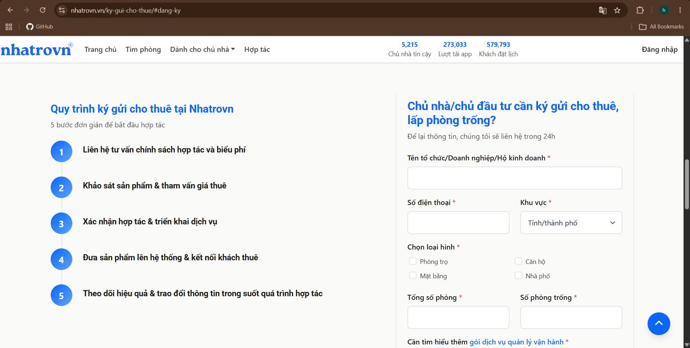

# Research Notes: Existing Application Survey

## 1. Application 1: Nhatot (nhatot.com)

### 1.1. Nhatot - User Flows & Observations

* **Tenant Flow:** The navigation is highly intuitive. Users can easily select categories like "Cho thuê" (Rent) -> "Phòng trọ" (Room) directly from the homepage menu. The search results page features a very robust filtering system, allowing users to narrow down results by specific price ranges (e.g., 2-3 million), area size (e.g., 30-40 m2), and furniture status. On the listing details page, users can view comprehensive descriptions, landlord profiles, and use a sticky contact bar to save the listing, chat, or view the phone number.
* **Landlord Flow:** Clicking the "Đăng tin" (Post listing) button opens a structured, step-by-step form. Landlords must specify the property type and purpose (Rent/Sell). The system strictly requires uploading at least 3 images or videos to ensure listing quality. It also includes dedicated input fields for rental price, deposit amount, a 1500-character description, and requires the user to declare whether they are an individual or a broker.

### 1.2. Nhatot - Outstanding Features

* **Granular Filtering System:** Advanced dropdown filters for price, area, and amenities make finding specific rooms highly efficient.
* **Verified Profiles & Badges:** Clear identification badges for landlords, such as "Môi giới" (Broker) or "Đối tác" (Partner), along with their activity status and ratings, help build trust.
* **Integrated Chat:** A real-time chat popup is available directly on the listing page, allowing seamless communication without switching screens.
* **Detailed Landlord/Broker Profiles:** Users can click to view a dedicated public profile page for the landlord or broker, showing their ratings, follower count, description, and all active listings, which significantly increases transparency and trust.

### 1.3. Useful UI/UX Patterns (and what Roomify will do differently/better)

* **Pattern from Nhatot:** The sticky contact bar on the listing page ensures that the call-to-action (Chat/Call) is always accessible. The step-by-step categorization in the posting form prevents cognitive overload for landlords.
* **Roomify's Improvement:** While Nhatot's filtering system is powerful, the interface can feel slightly cluttered with many dropdowns. Roomify will design a cleaner, more modern, and minimalist UI for the search interface. Furthermore, unlike Nhatot's traditional list view, Roomify will prioritize an Interactive Map-Based Browsing experience as the primary way to explore properties. Most importantly, instead of relying solely on manual dropdown filters, Roomify will introduce an AI-powered Chatbot. Users will be able to type natural language queries (e.g., "Find me a room under 3 million with air conditioning"), and the AI will automatically extract these parameters to display matching results, offering a vastly superior and more intuitive user experience.

## 2. Application 2: Nhatrovn (nhatrovn.vn)

### 2.1. User Flows & Observations

* **Tenant Flow:** The search interface relies on traditional dropdown menus (Location, Room Type, Price Range) rather than a free-text search bar. The search results are displayed as a grid of cards, prominently featuring status tags like "Trống 17/31 phòng" (17/31 rooms available) or "Sắp hết" (Almost full). The room detail page is highly informative, using icons to break down specific costs (electricity, water, parking) and house rules (curfew, pets).
* **Landlord Flow:** Unlike platforms where landlords directly post and manage listings themselves, Nhatrovn operates on a "Ký gửi" (Consignment) model. Landlords fill out a lead capture form with their contact details, property type, and the total number of vacant rooms. They do not upload photos or write descriptions directly; instead, they submit this form, and Nhatrovn's staff handles the listing process after consultation.

### 2.2. Outstanding Features

* **Granular Cost & Rule Breakdown:** The use of clear icons on the detail page to list out specific utility costs (e.g., 3.8k/kWh, 150k/room) and constraints makes financial planning easier for students.
* **Direct Viewing Appointment:** A prominent "Đặt lịch hẹn" (Book a viewing) button is integrated directly into the listing page, allowing tenants to schedule a specific date and time without needing to chat first.

### 2.3. Useful UI/UX Patterns (and what Roomify will do differently/better)

* **Pattern from Nhatrovn:** Explicitly stating the availability status (e.g., "15/30 rooms available") creates a sense of urgency. The clear breakdown of utility costs via icons is an excellent pattern for transparency.
* **Roomify's Improvement:** Nhatrovn's consignment model for landlords creates a bottleneck, as landlords cannot independently manage or update their listings in real-time. Roomify will adopt a self-service model for landlords (similar to Nhatot), providing them with an intuitive dashboard to add, edit, and manage their listings directly. However, Roomify will incorporate Nhatrovn's excellent UI pattern of breaking down utility costs (electricity, water, internet) using standardized input fields during the listing creation process, ensuring all listings on Roomify are transparent regarding hidden fees. To facilitate seamless coordination for room viewings without Nhatrovn's complex booking system, Roomify will implement Direct In-App Messaging to let tenants and landlords negotiate directly.

## 3. Existing App Comparison & Roomify's Approach

### 3.1. Common Features
Both Nhatot and Nhatrovn share essential room rental functionalities:
* **Search and Filter:** Both rely on traditional dropdown menus to filter properties by location, price range, and room type.
* **Detailed Listings:** Both provide comprehensive property pages, including images, descriptions, prices, and landlord contact details.
* **Landlord Workflows:** Both platforms feature dedicated pathways for landlords to supply inventory, although their operational models differ (Self-service vs. Consignment).

### 3.2. Useful UI/UX Patterns to Adopt
* From **Nhatot**: Roomify will adopt the **sticky contact bar** on listing pages to ensure the primary call-to-action is always seamlessly accessible. The step-by-step form categorization is also a great pattern to prevent cognitive overload during listing creation.
* From **Nhatrovn**: Roomify will implement their **granular utility cost breakdown** using distinct icons and standardized input fields, as well as their **urgency status tags** (e.g., "Sắp hết") to enhance transparency and decision-making.

### 3.3. What Roomify Will Do Differently (Project Proposal Alignment)
* **Interactive Map-Based Browsing:** Unlike the traditional list and grid views utilized by both competitors, Roomify will prioritize a dynamic map interface, allowing users to visually explore neighborhoods, amenities, and available properties in real-time.
* **AI-Powered Chatbot:** Both existing apps rely on manual, sometimes cluttered, dropdown filters. Roomify will overcome this by introducing an intelligent NLP chatbot. Users can simply type their requirements naturally, and the AI will automatically extract parameters and return precise matches.
* **Self-Service & Direct Messaging:** Unlike Nhatrovn's consignment bottleneck, Roomify will empower landlords with a self-service management dashboard. Furthermore, Roomify will feature built-in in-app messaging to facilitate direct, private negotiations.

## 4. Existing App Screenshots

### 4.1. Nhatot (nhatot.com)

**Figure 1: Advanced Search and Filtering (Tenant Flow)**

*Caption:* This screen shows the search interface for tenants. The feature works by allowing users to select multiple criteria simultaneously from dropdown menus, such as location, specific price range, and area size, to quickly narrow down the list of available rooms.

**Figure 2: Listing Details and Sticky Contact Bar (Tenant Flow)**

*Caption:* This is the room details page displaying images, descriptions, and the landlord's profile. The key feature is the sticky contact bar at the bottom, which remains visible as the user scrolls, allowing tenants to instantly call, save the listing, or open a chat dialog.

**Figure 3: Real-time Chat Integration**

*Caption:* This screen demonstrates the integrated chat functionality. Tenants can send direct messages or use quick-reply suggestions to communicate with the landlord without leaving the listing page.

**Figure 4: Post a Listing Form (Landlord Flow)**

*Caption:* This screen displays the listing creation form for landlords. The feature works by guiding the user step-by-step to upload mandatory photos/videos, input rental prices, write descriptions, and declare their broker status, ensuring data consistency.

### 4.2. Nhatrovn (nhatrovn.vn)

**Figure 5: Homepage and Basic Search (Tenant Flow)**

*Caption:* This screen shows the homepage search bar. Users select their desired location, room type, and price range from predefined fields to initiate the search process.

**Figure 6: Search Results and Availability Tags**

*Caption:* The search results page displays room listings in a grid layout. A standout feature is the prominent availability tags (e.g., "Sắp hết"), which work by dynamically showing real-time vacancy to create a sense of urgency for tenants.

**Figure 7: Detailed Utility Breakdown and Booking (Tenant Flow)**

*Caption:* This detail screen provides a comprehensive breakdown of room amenities and extra costs (electricity, water, parking) using clear icons. It also features a "Đặt lịch hẹn" (Book a viewing) button, allowing tenants to directly schedule a visit based on available time slots.

**Figure 8: Consignment Registration Form (Landlord Flow)**

*Caption:* This screen shows the consignment form for landlords. Instead of posting directly, landlords use this form to submit their property details (type, total rooms, vacant rooms) and contact information to the Nhatrovn team, who will then handle the listing process.