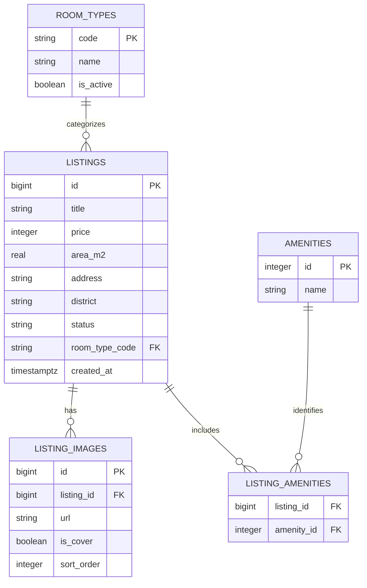

# Data Model: Search and Filtering

**Performed by:** Nguyễn Hữu Nghĩa | **Reviewed by:** Đỗ Quốc Đại | **Edited by:** Nguyễn Hữu Nghĩa

**Feature**: [spec.md](./spec.md)

**Plan**: [plan.md](./plan.md)

## Entity Relationship

## Persistent Entities

### Listing

Existing persistent entity in `listings`; public search adds a room-type relationship.

| Field | Type/Source | Rules |
|---|---|---|
| `id` | Existing `bigserial` | Stable public identifier; serialize as a decimal string in API responses. |
| `title` | Existing `varchar(150)` | Public summary and keyword-search field. |
| `description` | Existing `text` | Public detail field when present; not required for search matching. |
| `price` | Existing positive integer | VND per month; maximum-price comparison is inclusive. |
| `area_m2` | Existing positive real | Square meters; selected lower and upper bounds are inclusive. |
| `address` | Existing `varchar(255)` | Public address and keyword-search field. |
| `district` | Existing `varchar(100)` | Public location and keyword-search field; exact district filter. |
| `status` | Existing status | Only `approved` rows can be returned publicly. |
| `created_at` | Existing timestamp | Sort descending, followed by `id` descending. |
| room type reference | New migration | Must reference an active, team-approved catalog value. Existing-row mapping must be defined before making the reference mandatory. |

The API must not expose `owner_id`, `reviewed_by`, rejection metadata, user records, or other private fields.

### RoomType

New lookup entity shared by listing entry and public search.

| Field | Type | Rules |
|---|---|---|
| `code` | String primary key | Stable canonical value agreed with listing creation. |
| `name` | String | User-visible label; unique in the catalog. |
| `is_active` | Boolean | Inactive values cannot be selected for new searches or new listing entry; historical approved listings retain their association. |

The supported `code`/`name` set is not specified in the repository. Do not create the final seed data or map existing listing rows until feature owners agree on the catalog and backfill.

### Amenity and ListingAmenity

Reuse the existing `amenities` and `listing_amenities` tables. Amenity identifiers are accepted only when they exist. A listing matches multiple selected amenities only if it is associated with every selected ID.

### ListingImage

Reuse `listing_images`. Select the cover image when available, otherwise the first image by `sort_order` and stable image identifier. A listing with no image returns a null cover-image value.

## Search Criteria

| Field | Meaning and validation |
|---|---|
| `keyword` | Optional trimmed text searched against title, address, and district. Repeated whitespace is normalized; empty-after-trim is treated as absent. |
| `district` | Optional exact supported district value. |
| `roomType` | Optional active room-type code from `RoomType`. |
| `maxPrice` | Optional positive integer in VND/month; inclusive upper bound. |
| `minAreaM2` | Optional positive numeric lower bound, inclusive. |
| `maxAreaM2` | Optional positive numeric upper bound, inclusive. If both are present, minimum must not exceed maximum. |
| `amenityIds` | Zero or more distinct existing amenity IDs; all selected amenities are required. |
| `page` | Positive integer, default `1`. Page size is fixed at `12`. |

Unsupported filter values and malformed values are validation errors; they must never be ignored in a way that broadens results.

## Search Result

A public projection containing only fields required by the result card and approved-listing detail view:

- Identifier, title, description (detail only), price, area, address, district, room-type code and label, cover image, and amenity identifiers/names.
- No owner/account details, moderation notes, or private fields.
- Results are approved-only and ordered by `created_at DESC, id DESC`.

The paginated response contains the result array plus `page`, fixed `limit` (`12`), and total matching record count. Filters and keyword are preserved when the page changes.

## Migration and Integrity Notes

1. Add the room-type catalog and listing association in a new versioned migration; do not edit the applied initial migration.
2. Agree on canonical values and map any existing listing rows before enforcing a non-null relationship. A migration must fail visibly rather than assign an inaccurate category.
3. Preserve current listing moderation semantics. Room availability is not modeled by the existing schema and is not introduced by this feature.
4. Reuse existing price/area and amenity integrity rules. Validate public query input at the API boundary and still bind all values in SQL.
