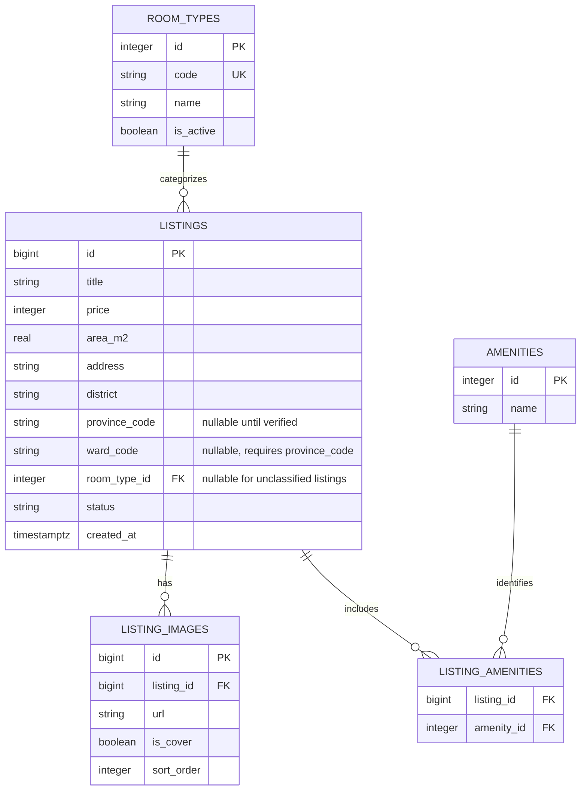

# Data Model: Search and Filtering

**Performed by:** Nguyễn Hữu Nghĩa | **Reviewed by:** Đỗ Quốc Đại | **Edited by:** Nguyễn Hữu Nghĩa

**Feature**: [spec.md](./spec.md)

**Plan**: [plan.md](./plan.md)

## Entity Relationship

## Persistent Entities

### Listing

Existing persistent entity in `listings`; this feature uses its room-type relationship and the nullable province/ward codes added for post-merger location filtering.

| Field | Type/Source | Rules |
|---|---|---|
| `id` | Existing `bigserial` | Stable public identifier; serialize as a decimal string in API responses. |
| `title` | Existing `varchar(150)` | Public summary and keyword-search field. |
| `description` | Existing `text` | Public detail field when present; not required for search matching. |
| `price` | Existing positive integer | VND per month; maximum-price comparison is inclusive. |
| `area_m2` | Existing positive real | Square meters; selected lower and upper bounds are inclusive. |
| `address` | Existing `varchar(255)` | Public address and keyword-search field. |
| `district` | Existing `varchar(100)` | Public location and keyword-search field. An exact district filter remains available in the API, but the current UI has no separate district selector. |
| `province_code` | Nullable `varchar(2)` | Verified post-merger province/city code. Null on unclassified legacy listings. |
| `ward_code` | Nullable `varchar(5)` | Verified ward/commune/special-zone code; requires `province_code`. |
| `status` | Existing status | Only `approved` rows can be returned publicly. |
| `created_at` | Existing timestamp | Sort descending, followed by `id` descending. |
| `room_type_id` | New nullable integer FK | References `room_types.id` for classified listings. Existing rows whose type cannot be determined reliably remain null; never assign an inferred category. |

The API must not expose `owner_id`, `reviewed_by`, rejection metadata, user records, or other private fields.

The current listing create/update API does not accept or populate `province_code` or `ward_code`. Search fixtures that exercise these filters must set verified codes explicitly; ordinary listings without verified codes remain unclassified.

### RoomType

New lookup entity shared by listing entry and public search.

| Field | Type | Rules |
|---|---|---|
| `id` | Integer primary key | Internal relational key referenced by listings. |
| `code` | Unique string | One of `private_room`, `shared_room`, `studio`, or `apartment`; stable value shared with listing creation and exposed by the API. |
| `name` | String | User-visible label: “Phòng trọ riêng”, “Phòng ở ghép”, “Studio / căn hộ mini”, or “Căn hộ chung cư”; unique in the catalog. |
| `is_active` | Boolean | Inactive values cannot be selected for new searches or new listing entry; historical approved listings retain their association. |

These initial catalog values are the feature owner's decision dated 2026-11-16. Share the same codes with the listing-creation owner. Whole-house listings are not in scope. Existing rows that cannot be classified from reliable data remain null and are presented as “Chưa phân loại”; a room-type filter does not include them.

### Amenity and ListingAmenity

Reuse the existing `amenities` and `listing_amenities` tables. Amenity identifiers are accepted only when they exist. A listing matches multiple selected amenities only if it is associated with every selected ID.

### ListingImage

Reuse `listing_images`. Select the cover image when available, otherwise the first image by `sort_order` and stable image identifier. A listing with no image returns a null cover-image value.

## Search Criteria

| Field | Meaning and validation |
|---|---|
| `keyword` | Optional trimmed text searched against title, address, and district. Repeated whitespace is normalized; empty-after-trim is treated as absent. |
| `provinceCode` | Optional 2-digit code from the shared administrative-unit catalog. |
| `wardCode` | Optional 5-digit code belonging to `provinceCode`; invalid without its parent province. |
| `district` | Optional exact supported district value accepted by the API for compatibility; the current UI has no separate district selector and searches district text through `keyword`. |
| `roomType` | Optional active room-type code from `RoomType`. |
| `maxPrice` | Optional positive integer in VND/month; inclusive upper bound. |
| `minAreaM2` | Optional positive numeric lower bound, inclusive. |
| `maxAreaM2` | Optional positive numeric upper bound, inclusive. If both are present, minimum must not exceed maximum. |
| `amenityIds` | Zero or more distinct existing amenity IDs; all selected amenities are required. |
| `page` | Positive integer, default `1`. Page size is fixed at `12`. |

Unsupported filter values and malformed values are validation errors; they must never be ignored in a way that broadens results.

## Search Result

A public projection containing only fields required by the result card and approved-listing detail view:

- Identifier, title, description (detail only), price, area, address, district, nullable province/ward codes, room-type code and label, cover image, and amenity identifiers/names.
- No owner/account details, moderation notes, or private fields.
- Results are approved-only and ordered by `created_at DESC, id DESC`.

The paginated response contains the result array plus `page`, fixed `limit` (`12`), and total matching record count. Filters and keyword are preserved when the page changes.

## Migration and Integrity Notes

1. Add the room-type catalog and listing association in a new versioned migration; do not edit the applied initial migration.
2. Add nullable province/ward columns in a separate versioned migration, require a province when a ward is set, and index the code pair. Do not infer or backfill unverified legacy locations.
3. Seed exactly the four confirmed room-type catalog values. Keep legacy listing references nullable when no reliable mapping exists; do not assign an inaccurate category or make the column non-null until listing creation guarantees a valid type for new rows.
4. Preserve current listing moderation semantics. Room availability is not modeled by the existing schema and is not introduced by this feature.
5. Reuse existing price/area and amenity integrity rules. Validate public query input at the API boundary and still bind all values in SQL.
