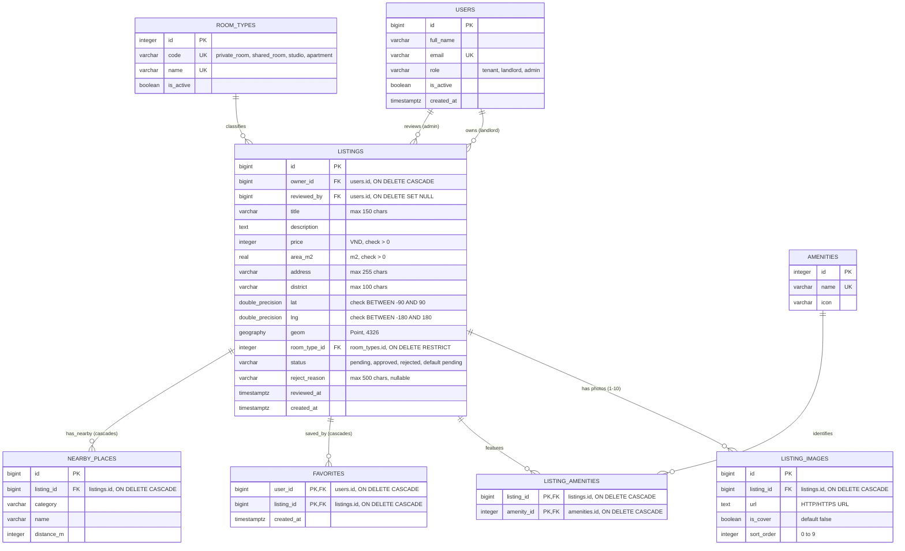
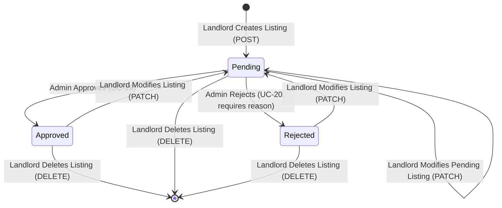

# Data Model: Comprehensive Listing Management

**Performed by:** Từ Thái Hưng | **Reviewed by:** Đỗ Quốc Đại | **Edited by:** Từ Thái Hưng

**Feature**: [spec.md](./spec.md)

**Plan**: [plan.md](./plan.md)

---

## Entity Relationship

**Performed by:** Từ Thái Hưng | **Reviewed by:** Đỗ Quốc Đại | **Edited by:** Từ Thái Hưng



---

## Database Schema vs. API Field Mapping (camelCase)

**Performed by:** Từ Thái Hưng | **Reviewed by:** Đỗ Quốc Đại | **Edited by:** Từ Thái Hưng

Per `docs/coding-standards.md`, the relational PostgreSQL schema retains snake_case column names, while all external JSON API contracts, Zod schemas, and JavaScript domain properties use `camelCase`:

| Database Table & Column | API JSON Property (camelCase) | Type / Constraints | Description |
|---|---|---|---|
| `listings.id` | `id` | `string` (canonical BIGINT) | Unique listing identifier. |
| `listings.owner_id` | `ownerId` | `string` (canonical BIGINT) | Landlord creator account ID. |
| `listings.title` | `title` | `string` (5–150 chars) | Listing headline. |
| `listings.description` | `description` | `string` (max 2000 chars, nullable) | Detailed property description. |
| `listings.price` | `price` | `integer` (> 0) | Monthly rent in VND. |
| `listings.area_m2` | `areaM2` | `number` (> 0) | Floor area in square meters. |
| `listings.address` | `address` | `string` (5–255 chars) | Street address. |
| `listings.district` | `district` | `string` (2–100 chars) | Administrative district name. |
| `listings.lat` | `lat` | `number` ([-90, 90]) | Latitude coordinate. |
| `listings.lng` | `lng` | `number` ([-180, 180]) | Longitude coordinate. |
| `listings.geom` | *(internal)* | `geography(Point,4326)` | PostGIS spatial point. |
| `listings.room_type_id` | `roomTypeId` (in request) / `roomType` (in response) | `integer` / `object` | Room classification ID / object. |
| `listings.status` | `status` | `'pending'\|'approved'\|'rejected'` | Moderation state. |
| `listings.reject_reason`| `rejectReason` | `string` (nullable) | Feedback note from admin if rejected. |
| `listings.created_at` | `createdAt` | `string` (ISO 8601) | Creation timestamp. |
| `listing_images.url` | `url` (in `images`) / `imageUrls` (in request) | `string` (URL) / `array[string]` | Public photo URL(s). |
| `listing_images.is_cover`| `isCover` / `coverImageUrl` | `boolean` / `string` (URL) | Primary thumbnail flag / URL. |
| `listing_images.sort_order`| `sortOrder` | `integer` (0-9) | Photo sequence index. |
| `listing_amenities.amenity_id`| `amenityIds` (in request) / `amenities` (in response) | `array[integer]` / `array[object]` | Selected amenities list. |

---

## State Transition Model

**Performed by:** Từ Thái Hưng | **Reviewed by:** Đỗ Quốc Đại | **Edited by:** Từ Thái Hưng

The listing moderation lifecycle is governed by the following state transitions:



### Transition Invariants
1. **Initial Creation**: Every newly inserted listing row is assigned `status = 'pending'`, `reject_reason = NULL`, `reviewed_by = NULL`, and `reviewed_at = NULL`.
2. **Re-Moderation on Modification**: Any update (`PATCH`) that modifies substantive listing data unconditionally sets `status = 'pending'`, `reject_reason = NULL`, `reviewed_by = NULL`, and `reviewed_at = NULL`.
3. **No-op Modification**: If an update payload is identical to current stored values, existing status and rejection reason are retained.
4. **Deletion Cascade**: Physical deletion of a listing cascades to `listing_images`, `listing_amenities`, `nearby_places`, and `favorites`.

---

## Validation Rules (Zod Schemas in camelCase)

**Performed by:** Từ Thái Hưng | **Reviewed by:** Đỗ Quốc Đại | **Edited by:** Từ Thái Hưng

All incoming request payloads are strictly validated using Zod with `.strict()` to disallow unknown attributes.

### 1. Create Listing Schema (`createListingSchema`)
```javascript
const createListingSchema = z.object({
  title: z.string().trim().min(5, 'Title must be at least 5 characters').max(150, 'Title cannot exceed 150 characters'),
  description: z.string().trim().max(2000, 'Description cannot exceed 2000 characters').optional().nullable(),
  price: z.number().int().positive('Price must be a positive integer in VND'),
  areaM2: z.number().positive('Area must be a positive number in square meters'),
  address: z.string().trim().min(5, 'Address must be at least 5 characters').max(255, 'Address cannot exceed 255 characters'),
  district: z.string().trim().min(2, 'District must be at least 2 characters').max(100, 'District cannot exceed 100 characters'),
  lat: z.number().min(-90, 'Latitude must be >= -90').max(90, 'Latitude must be <= 90'),
  lng: z.number().min(-180, 'Longitude must be >= -180').max(180, 'Longitude must be <= 180'),
  roomTypeId: z.number().int().positive('Room type ID must be a positive integer'),
  amenityIds: z.array(z.number().int().positive()).optional().default([]),
  imageUrls: z.array(z.string().url('Each photo must be a valid URL')).min(1, 'At least 1 photo is required').max(10, 'Maximum 10 photos allowed')
}).strict();
```

### 2. Update Listing Schema (`updateListingSchema`)
```javascript
const updateListingSchema = z.object({
  title: z.string().trim().min(5).max(150).optional(),
  description: z.string().trim().max(2000).optional().nullable(),
  price: z.number().int().positive().optional(),
  areaM2: z.number().positive().optional(),
  address: z.string().trim().min(5).max(255).optional(),
  district: z.string().trim().min(2).max(100).optional(),
  lat: z.number().min(-90).max(90).optional(),
  lng: z.number().min(-180).max(180).optional(),
  roomTypeId: z.number().int().positive().optional(),
  amenityIds: z.array(z.number().int().positive()).optional(),
  imageUrls: z.array(z.string().url()).min(1).max(10).optional()
}).strict().refine(data => Object.keys(data).length > 0, {
  message: 'At least one field must be provided for update'
});
```

### 3. Query Landlord Listings Schema (`queryMineSchema`)
```javascript
const queryMineSchema = z.object({
  status: z.enum(['all', 'pending', 'approved', 'rejected']).optional().default('all')
}).strict();
```

---

## Pessimistic Locking and Concurrency Protocol

**Performed by:** Từ Thái Hưng | **Reviewed by:** Đỗ Quốc Đại | **Edited by:** Từ Thái Hưng

To protect data consistency and enforce the project constitution:
1. **Lock Acquisition Order**:
   - Step 1: `SELECT role, is_active FROM users WHERE id = $1 FOR UPDATE`
     Verifies the current database role is `'landlord'` and account is active.
   - Step 2 (for mutations on existing listings): `SELECT id, owner_id, status, ... FROM listings WHERE id = $1 FOR UPDATE`
     Verifies existence and ownership.
2. **Transaction Isolation**:
   - Wrap operations in `BEGIN ... COMMIT / ROLLBACK` using a dedicated pooled client.
   - Any database error immediately rolls back the transaction before releasing the client.
